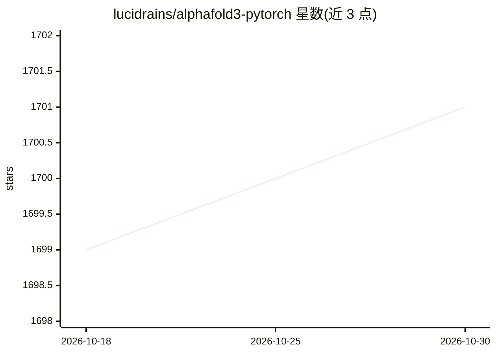

# lucidrains/alphafold3-pytorch

⭐ 1,701 · Python · MIT · 推送 2026-08-10 · [GitHub](https://github.com/lucidrains/alphafold3-pytorch) · 个人维护

**Google DeepMind AlphaFold 3 的 PyTorch 复现，供科研复现与训练**

由 lucidrains（Phil Wang）维护的 AlphaFold 3 开源实现，用 PyTorch 转写论文算法，覆盖分子级输入处理、原子扩散模块、置信度度量等。面向希望复现、训练或微调蛋白质及生物分子结构预测模型的研究者。提供 PDB 数据集下载、过滤与聚类的完整数据准备脚本（数据下载可达 700GB），附 Docker 镜像（基于 PyTorch/CUDA 基础镜像）支持 GPU 训练与推理。另存在社区维护的 Lightning+Hydra 分支与 Triton 优化版本 MegaFold。

## 筛选速览

| 维度 | 判定 | 备注 |
|---|---|---|
| AI 角色 | `ai-native` | 本体是模型或模型工具 |
| 许可风险 | `permissive` | MIT |
| 部署形态 | `self-host` | docker 或自建部署 |
| 模型依赖 | — | README 未给出锁定关系 |
| 硬件要求 | — | 无带数字的原话,不猜 |
| 安装摩擦 | `low` | 无编译、无系统依赖或容器化 |
| 成熟度 | — | 结构信号不足 |

## 能力要点

- PyTorch 实现 AlphaFold 3（含分子级输入与原子扩散模块）
- PDB 数据集过滤、聚类与蒸馏数据准备的完整脚本链
- 提供基于 CUDA 的 Docker 镜像用于训练/推理
- 包含置信度度量、clash penalty 排序等贡献模块

## 适用场景

- 复现或改进 AlphaFold 3 蛋白质复合物结构预测
- 在自有数据集上训练/微调生物分子结构预测模型
- 作为框架代码学习 AlphaFold 3 各模块实现

## 场景标签

`科研工具` `微调` · 领域:学习与行业

## 证据(README 行号)

> L5: Implementation of Alphafold 3 in Pytorch
> L176: The included `Dockerfile` contains the required dependencies to run the package and to train/inference using PyTor

## 星数曲线

2026-10-18 1,699 → 2026-10-30 1,701（+2）

---
*卡片 v1 · prompt 1.4 · 生成 2026-10-21 · 置信度 high · 依据 README sha `d9ad0f98fe6d` · [字段定义](../../DATASET.md)*
