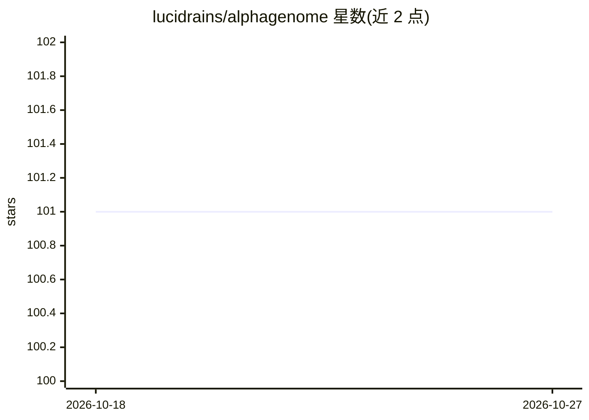

# lucidrains/alphagenome

⭐ 101 · Jupyter Notebook · MIT · 推送 2026-03-25 · [GitHub](https://github.com/lucidrains/alphagenome) · 个人维护

**DeepMind AlphaGenome 基因组注意力模型的 PyTorch 复现**

lucidrains 实现的 AlphaGenome——DeepMind 的基因组注意力模型（DNA 序列调控变异效应预测）的 PyTorch 版本，架构已与官方 JAX 实现对齐，支持加载官方 JAX 预训练权重并做转换。提供 unet transformer 主体、多种输出头（含剪接预测头）、训练脚本与测试套件；预训练权重需通过 HF_TOKEN 从 HuggingFace 获取。官方代码发布后项目转由 Anshul Kundaje 实验室继续维护。

## 筛选速览

| 维度 | 判定 | 备注 |
|---|---|---|
| AI 角色 | `ai-native` | 本体是模型或模型工具 |
| 许可风险 | `permissive` | MIT |
| 部署形态 | `library` | 以包/库形式分发 |
| 模型依赖 | — | README 未给出锁定关系 |
| 硬件要求 | — | 无带数字的原话,不猜 |
| 安装摩擦 | `low` | 无编译、无系统依赖或容器化 |
| 成熟度 | — | 结构信号不足 |

## 能力要点

- 与官方 JAX 实现对齐，兼容预训练权重
- 提供多种输出头（含剪接预测头）与损失函数
- TFRecord 数据集支持及评分、评估模块
- 提供权重转换工具与回归测试套件

## 适用场景

- 用 PyTorch 生态做基因组序列建模与剪接预测
- 加载 DeepMind 官方 JAX 预训练权重继续研究
- 在自有数据上微调 DNA 序列调控预测模型

## 场景标签

 · 领域:基因组学/深度学习

## 证据(README 行号)

> L5: Implementation of AlphaGenome, Deepmind's updated genomic attention model
> L15: - Xinming Tu for aligning the architecture with the official JAX implementation, enabling pretrained weight compati
> L125:     author  = {Avsec, {\v Z}iga and Latysheva, Natasha and Cheng, Jun and Novati, Guido and Taylor, Kyle R. and Wa

## 星数曲线

2026-10-18 101 → 2026-10-27 101（+0）

---
*卡片 v1 · prompt 1.4 · 生成 2026-10-23 · 置信度 high · 依据 README sha `34a92fef0a15` · [字段定义](../../DATASET.md)*
