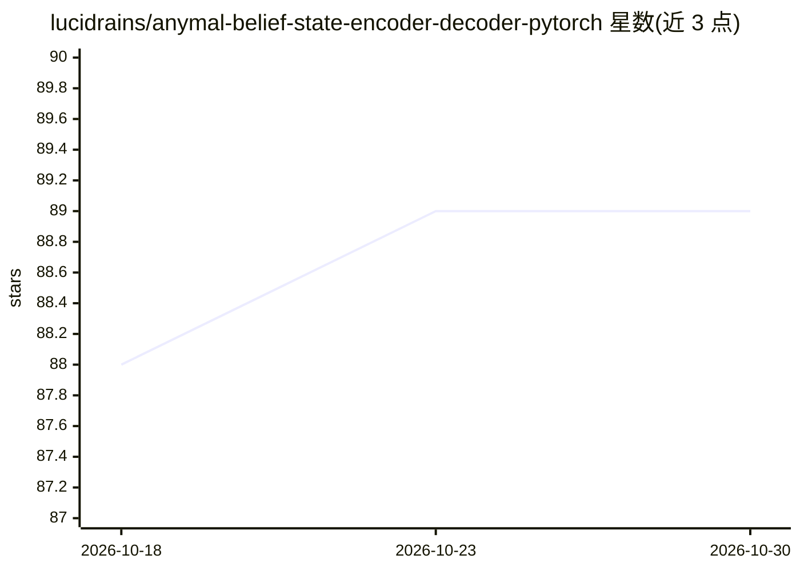

# lucidrains/anymal-belief-state-encoder-decoder-pytorch

⭐ 89 · Python · MIT · 推送 2026-08-16 · [GitHub](https://github.com/lucidrains/anymal-belief-state-encoder-decoder-pytorch) · 个人维护

**ETH Zürich 四足机器人论文信念状态编解码器的 PyTorch 实现**

对苏黎世联邦理工学院论文《Learning robust perceptive locomotion for quadrupedal robots in the wild》中 Belief State Encoder/Decoder 的 PyTorch 复现，面向机器人学与深度学习研究者。提供 Teacher、Student 及二者合一的 Anymal 封装类，附带基于模拟环境包装器的 PPO 训练逻辑与 Student 蒸馏训练循环。Todo 显示 student 训练尚未修正、噪声调度器与奖励设计等条目未完成；实际训练需自行接入仿真器环境。

## 筛选速览

| 维度 | 判定 | 备注 |
|---|---|---|
| AI 角色 | `ai-native` | 本体是模型或模型工具 |
| 许可风险 | `permissive` | MIT |
| 部署形态 | `library` | 以包/库形式分发 |
| 模型依赖 | — | README 未给出锁定关系 |
| 硬件要求 | — | 无带数字的原话,不猜 |
| 安装摩擦 | `low` | 无编译、无系统依赖或容器化 |
| 成熟度 | — | 结构信号不足 |

## 能力要点

- Teacher/Student 信念状态编解码器及合一封装类 Anymal
- 附带 Teacher 的 PPO 训练逻辑（MockEnv 需替换为仿真器包装）
- Student 蒸馏训练循环（重构损失 + 行为损失）
- 超参数按论文附录设定

## 适用场景

- 复现并研究 ANYmal 四足机器人的感知运动策略
- 在此基础上接入 MuJoCo 等仿真器做课程式训练实验
- 作为四足机器人 teacher-student 蒸馏的参考实现

## 场景标签

`强化学习` · 领域:训练与推理

## 证据(README 行号)

> L5: Implementation of the Belief State Encoder / Decoder in the new breakthrough robotics paper from ETH Zürich.
> L46: PPO training of the Teacher (using a mock environment, this needs to be substituted with a environment wrapper arou
> L79: - [ ] fix student training, it does not look correct

## 星数曲线

2026-10-18 88 → 2026-10-30 89（+1）

---
*卡片 v1 · prompt 1.4 · 生成 2026-10-23 · 置信度 high · 依据 README sha `d7bffab12910` · [字段定义](../../DATASET.md)*
