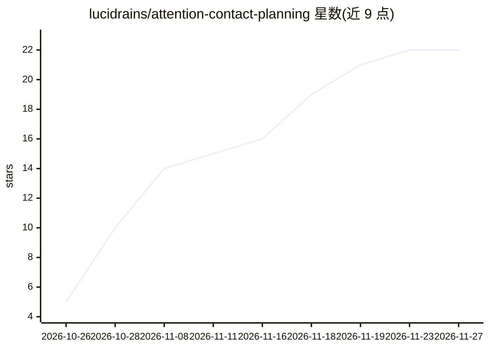

# lucidrains/attention-contact-planning

⭐ 22 · Python · MIT · 推送 2026-10-27 · [GitHub](https://github.com/lucidrains/attention-contact-planning) · 个人维护

**ETH 论文的注意力接触规划 PyTorch 实现，wip**

实现 ETH Zürich 论文 Humanoid Mobility via Attention-based Contacts 的研究代码：提供 CrossAttention 模块（body 查询对 terrain 点做交叉注意力，index 0 为学习的 no-contact slot）与 contact_probs_loss 损失函数，用于从注意力 logits 直接训练接触分布的软目标。以 pip 包形式安装，代码标注 wip（进行中）。面向机器人学与深度学习研究人员复现或扩展该方法。

## 筛选速览

| 维度 | 判定 | 备注 |
|---|---|---|
| AI 角色 | `ai-native` | 本体是模型或模型工具 |
| 许可风险 | `permissive` | MIT |
| 部署形态 | `library` | 以包/库形式分发 |
| 模型依赖 | — | README 未给出锁定关系 |
| 硬件要求 | — | 无带数字的原话,不猜 |
| 安装摩擦 | `low` | 无编译、无系统依赖或容器化 |
| 成熟度 | `idea` | |

## 能力要点

- CrossAttention：body 查询对 terrain 点的交叉注意力，含学习式 no-contact slot
- contact_probs_loss 从注意力 logits 训练接触分布软目标

## 适用场景

- 复现人形机器人接触规划的论文方法
- 在自有机器人运动研究中复用该注意力模块与损失函数

## 场景标签

`科研工具` · 领域:学习与行业

## 证据(README 行号)

> L3: Implementation of Humanoid Mobility via Attention-based Contacts (paper), out of ETH Zürich
> L13: The proposed cross attention, where body queries attend over terrain points, with a learned no-contact slot at inde

## 星数曲线

2026-10-26 5 → 2026-11-27 22（+17）

---
*卡片 v1 · prompt 1.4 · 生成 2026-11-18 · 置信度 high · 依据 README sha `9a61a68fc59f` · [字段定义](../../DATASET.md)*
