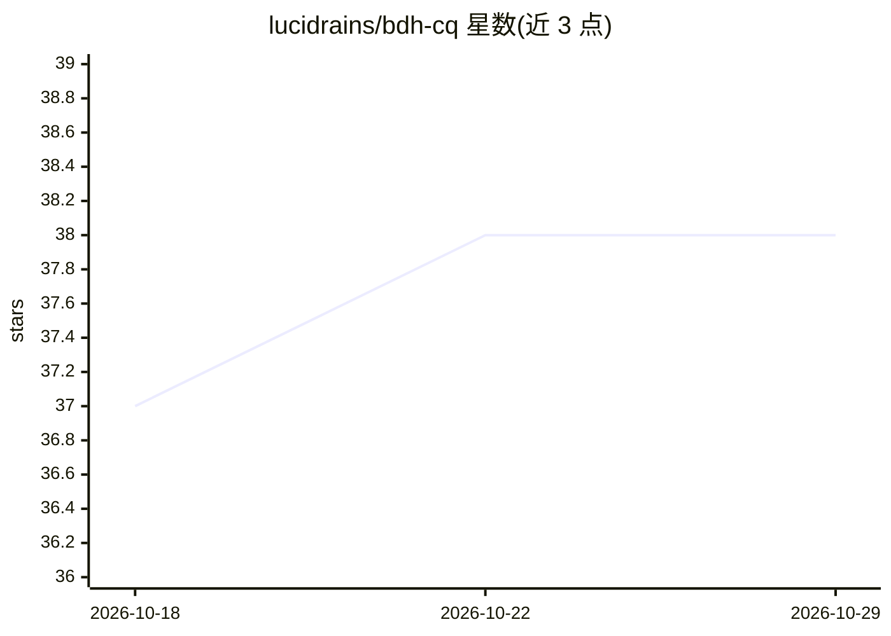

# lucidrains/bdh-cq

⭐ 38 · Python · MIT · 推送 2026-10-07 · [GitHub](https://github.com/lucidrains/bdh-cq) · 个人维护

**BDH-CQ 循环潜在推理 Transformer 的 PyTorch 实现**

对 Pathway Research 提出的 BDH-CQ（In-Context Learning with Recurrent Latent Reasoning）的模型实现，以 Python 库形式提供，pip 安装后导入 BDH 模块构建模型。支持将模型包装为 BDHReasoningWrapper，通过交替传入 token 块与潜在推理步骤实现循环潜在推理。README 标注 wip（开发中），含多篇相关论文引用（Attention Residuals、Poly-attention、Triadic Linear Attention 等）作为技术关联。

## 筛选速览

| 维度 | 判定 | 备注 |
|---|---|---|
| AI 角色 | `ai-native` | 本体是模型或模型工具 |
| 许可风险 | `permissive` | MIT |
| 部署形态 | `library` | 以包/库形式分发 |
| 模型依赖 | — | README 未给出锁定关系 |
| 硬件要求 | — | 无带数字的原话,不猜 |
| 安装摩擦 | `low` | 无编译、无系统依赖或容器化 |
| 成熟度 | `idea` | |

## 能力要点

- BDH 模型的 PyTorch 实现
- BDHReasoningWrapper 支持 token 块与潜在推理步骤交替的循环推理
- pip 可安装的 Python 库

## 适用场景

- 复现 BDH-CQ 论文的循环潜在推理机制
- 在自建训练流程中实验线性注意力与循环深度 Transformer

## 场景标签

`模型训练` · 领域:训练与推理

## 证据(README 行号)

> L3: Implementation of BDH-CQ: In-Context Learning with Recurrent Latent Reasoning, proposed by Pathway Research
> L20: For recurrent latent reasoning, wrap the model and pass an interleaving of

## 星数曲线

2026-10-18 37 → 2026-10-29 38（+1）

---
*卡片 v1 · prompt 1.4 · 生成 2026-10-25 · 置信度 high · 依据 README sha `85d032bbec1d` · [字段定义](../../DATASET.md)*
