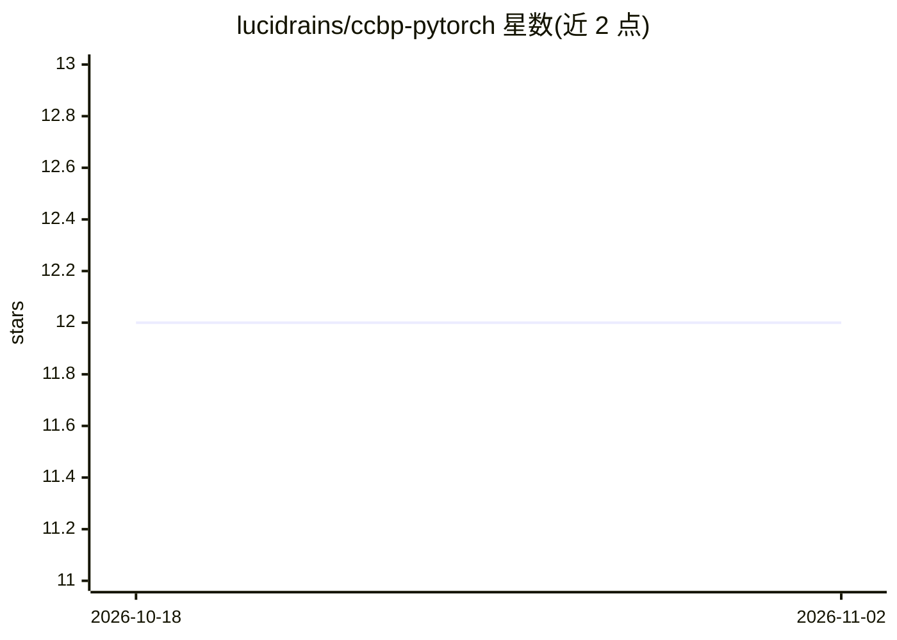

# lucidrains/ccbp-pytorch

⭐ 12 · Python · MIT · 推送 2026-09-03 · [GitHub](https://github.com/lucidrains/ccbp-pytorch) · 个人维护

**PyTorch 优化器包装器：缓解持续学习中的可塑性丧失**

实现 ICLR 2026 论文提出的 CCBP（连续持续反向传播）：一个轻量级包装器，可包裹任意 PyTorch 优化器，在非平稳环境下缓解深度网络的可塑性丧失；也支持离散版 Continual Backprop（Dohare et al.）。面向科研用户，提供自定义传输函数、效用估计函数的扩展钩子，以及非标准优化器（Lion/AdamAtan2/Muon）的动量缓冲名配置；内置 bit flipping 基准训练脚本。

## 筛选速览

| 维度 | 判定 | 备注 |
|---|---|---|
| AI 角色 | `ai-ecosystem` | LLM/agent 周边工具 |
| 许可风险 | `permissive` | MIT |
| 部署形态 | `library` | 以包/库形式分发 |
| 模型依赖 | — | README 未给出锁定关系 |
| 硬件要求 | — | 无带数字的原话,不猜 |
| 安装摩擦 | `low` | 无编译、无系统依赖或容器化 |
| 成熟度 | — | 结构信号不足 |

## 能力要点

- 可包裹任意 PyTorch 优化器的轻量级包装器
- 支持连续与离散（Dohare et al.）两种 Continual Backprop 模式
- 提供自定义传输函数与效用估计函数的研究钩子
- 兼容 Lion/AdamAtan2/Muon 等非标准优化器

## 适用场景

- 非平稳环境持续学习训练中缓解可塑性丧失
- 复现 CCBP 论文方法或进行变体研究
- 在自定义优化器上应用持续反向传播机制

## 场景标签

 · 领域:深度学习/持续学习

## 证据(README 行号)

> L3: Implementation of CCBP (Continuous Continual Backpropagation) from Learning Continually at Peak Performance with Con
> L5: A lightweight wrapper that can wrap any PyTorch optimizer to mitigate loss of plasticity in non-stationary settings

## 星数曲线

2026-10-18 12 → 2026-11-02 12（+0）

---
*卡片 v1 · prompt 1.4 · 生成 2026-11-01 · 置信度 high · 依据 README sha `90949e8e5432` · [字段定义](../../DATASET.md)*
