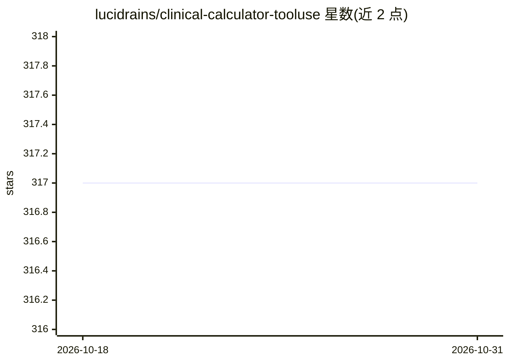

# lucidrains/clinical-calculator-tooluse

⭐ 317 · Python · MIT · 推送 2026-07-22 · [GitHub](https://github.com/lucidrains/clinical-calculator-tooluse) · 个人维护

**训练 LLM 从病史使用临床计算器的研究探索（起于 Wells 评分）**

lucidrains 的研究性探索项目：训练开源大模型根据患者病史调用临床计算器，首个目标为 Wells' Criteria（肺栓塞风险评估）。README 极简，仅含项目一句描述与相关论文的 BibTeX 引用（涵盖 Med-PaLM、ChatGPT USMLE、Toolformer、GPT-4 医学基准等），未提供安装命令、数据集或训练代码使用说明，处于早期探索阶段。面向 AI 与医学交叉方向的研究者与开发者。

## 筛选速览

| 维度 | 判定 | 备注 |
|---|---|---|
| AI 角色 | `ai-native` | 本体是模型或模型工具 |
| 许可风险 | `permissive` | MIT |
| 部署形态 | `None` |  |
| 模型依赖 | — | README 未给出锁定关系 |
| 硬件要求 | — | 无带数字的原话,不猜 |
| 安装摩擦 | `low` | 无编译、无系统依赖或容器化 |
| 成熟度 | — | 结构信号不足 |

## 能力要点

- 训练开源 LLM 从患者病史调用临床计算器
- 首个目标为 Wells' Criteria 临床评分
- README 引用 Toolformer、Med-PaLM 等相关工作

## 适用场景

- 研究者参考临床工具调用 LLM 训练思路
- 跟踪 lucidrains 医学 AI 实验仓库进展

## 场景标签

`微调` · 领域:训练与推理

## 证据(README 行号)

> L1: Explorations into training LLMs to use clinical calculators from patient history, using open sourced models. Will st

## 星数曲线

2026-10-18 317 → 2026-10-31 317（+0）

---
*卡片 v1 · prompt 1.4 · 生成 2026-10-21 · 置信度 mid · 依据 README sha `d228d9ccbb7f` · [字段定义](../../DATASET.md)*
