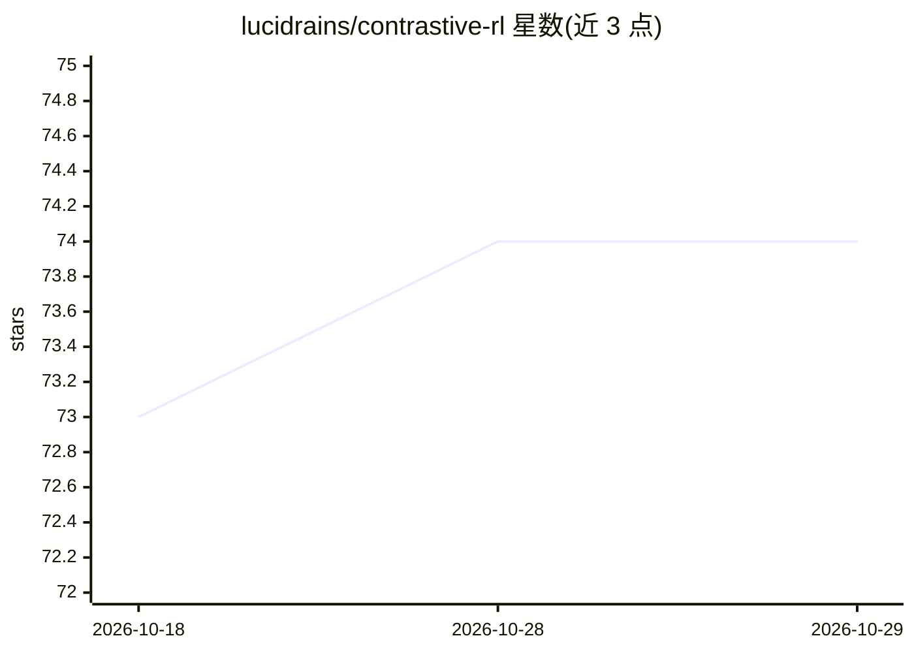

# lucidrains/contrastive-rl

⭐ 74 · Python · MIT · 推送 2026-10-26 · [GitHub](https://github.com/lucidrains/contrastive-rl) · 个人维护

**对比强化学习（Contrastive RL）PyTorch 实现库，供研究跟进**

lucidrains 维护的对比强化学习研究实现：将对比学习与目标条件 RL 统一，RL 与自监督学习共用同一算法。提供 ContrastiveRLTrainer 训练器，支持折扣因子条件化实现多时间尺度学习、Cayley 参数化正交转移 critic（C-Slerp）、ChronoSRL 的时间距离正则（L_time/L_sep）。附 CartPole 与 LunarLander 快速测试脚本（uv 运行，CartPole 数十 episode 内求解，LunarLander 需至少 3-5k 步）。面向强化学习研究者，pip 安装。

## 筛选速览

| 维度 | 判定 | 备注 |
|---|---|---|
| AI 角色 | `ai-native` | 本体是模型或模型工具 |
| 许可风险 | `permissive` | MIT |
| 部署形态 | `library` | 以包/库形式分发 |
| 模型依赖 | — | README 未给出锁定关系 |
| 硬件要求 | — | 无带数字的原话,不猜 |
| 安装摩擦 | `low` | 无编译、无系统依赖或容器化 |
| 成熟度 | — | 结构信号不足 |

## 能力要点

- 对比学习与 RL 算法统一的 ContrastiveRLTrainer
- 折扣因子条件化的多时间尺度（multi-horizon）学习
- 正交转移 critic（Cayley 参数化旋转目标嵌入）
- 时间距离正则 L_time/L_sep（ChronoSRL）

## 适用场景

- 跟进 2022 年起的对比强化学习研究路线
- 在 CartPole/LunarLander 上复现与验证算法
- 实验多时间尺度折扣条件化与正交 critic 变体

## 场景标签

`强化学习` · 领域:训练与推理

## 证据(README 行号)

> L5: For following a new line of research that started in 2022 from Eysenbach et al.
> L7: This is important not because of contrastive learning, but because it happens to be a special case where the RL and 

## 星数曲线

2026-10-18 73 → 2026-10-29 74（+1）

---
*卡片 v1 · prompt 1.4 · 生成 2026-10-24 · 置信度 high · 依据 README sha `2eb3b9b70613` · [字段定义](../../DATASET.md)*
