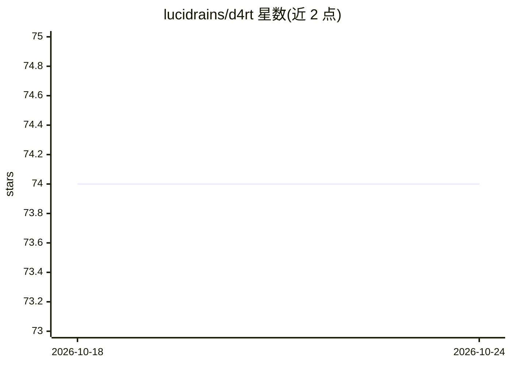

# lucidrains/d4rt

⭐ 74 · Python · MIT · 推送 2026-06-20 · [GitHub](https://github.com/lucidrains/d4rt) · 个人维护

**DeepMind D4RT 动态场景重建模型的 PyTorch 实现**

lucidrains 对 DeepMind 论文《Efficiently Reconstructing Dynamic Scenes One D4RT at a Time》的 PyTorch 复现实现，围绕注意力模型与流匹配构建。以 Python 库形式通过 pip 发布，提供 usage 代码示例（从 d4rt 导入 D4RT 类进行调用），并带 tests/ 目录供 pytest 运行贡献测试。README 未给出预训练权重、训练数据或硬件要求说明，引用文献为相关研究方向论文。

## 筛选速览

| 维度 | 判定 | 备注 |
|---|---|---|
| AI 角色 | `ai-native` | 本体是模型或模型工具 |
| 许可风险 | `permissive` | MIT |
| 部署形态 | `library` | 以包/库形式分发 |
| 模型依赖 | — | README 未给出锁定关系 |
| 硬件要求 | — | 无带数字的原话,不猜 |
| 安装摩擦 | `low` | 无编译、无系统依赖或容器化 |
| 成熟度 | — | 结构信号不足 |

## 能力要点

- D4RT 动态场景重建模型的独立 PyTorch 实现
- pip 安装的 Python 库形式，含使用示例
- 仓库含 tests/ 目录，贡献需通过 pytest 测试

## 适用场景

- 在自有环境中复现或实验 D4RT 动态场景重建方法
- 基于该实现进行 4D 重建/流匹配相关研究与改动

## 场景标签

 · 领域:计算机视觉/4D 重建

## 证据(README 行号)

> L5: Implementation of D4RT, Efficiently Reconstructing Dynamic Scenes, by Chuhan Zhang et al. from Deepmind
> L16: from torch import randn, randint

## 星数曲线

2026-10-18 74 → 2026-10-24 74（+0）

---
*卡片 v1 · prompt 1.4 · 生成 2026-10-24 · 置信度 high · 依据 README sha `0982c96745d1` · [字段定义](../../DATASET.md)*
