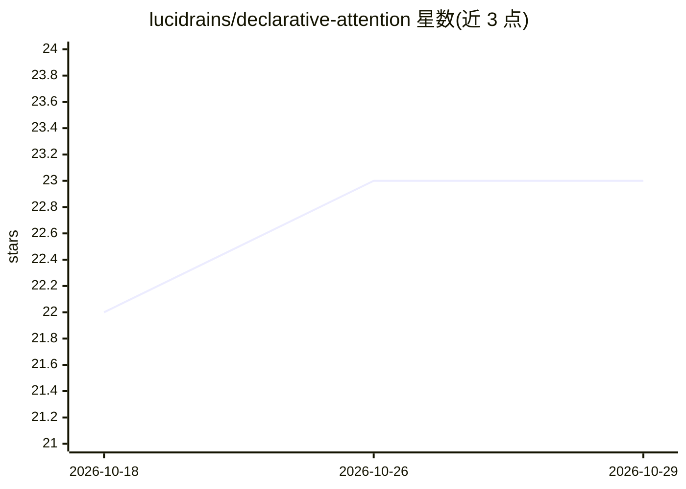

# lucidrains/declarative-attention

⭐ 23 · Python · MIT · 推送 2026-09-22 · [GitHub](https://github.com/lucidrains/declarative-attention) · 个人维护

**Pytorch 实现：语言模型通过输出标签声明自身注意力范围**

论文 Language Models Can Control Their Own Attention（KAIST AI）的 Pytorch 实现（wip）。机制：模型在输出流中声明 <global>/<focus>/<local> 标签控制每步可见的 KV chunk，全程 KV cache 驻留内存、掩码可逆、零驱逐。上下文切为约 2048 token 的 chunk，状态机自动追踪与还原嵌套标签；支持自定义标签状态机、vLLM 块级掩码钩子及 x-transformers 训练/生成集成。以 pip 包提供。

## 筛选速览

| 维度 | 判定 | 备注 |
|---|---|---|
| AI 角色 | `ai-native` | 本体是模型或模型工具 |
| 许可风险 | `permissive` | MIT |
| 部署形态 | `library` | 以包/库形式分发 |
| 模型依赖 | local-ok | 支持本地模型 |
| 硬件要求 | — | 无带数字的原话,不猜 |
| 安装摩擦 | `low` | 无编译、无系统依赖或容器化 |
| 成熟度 | `idea` | |

## 能力要点

- 模型用标签声明每步可见 chunk，KV cache 驻留、掩码可逆零驱逐
- 上下文自动切分约 2048 token chunk，标签属性自动归一化
- 可子类化自定义标签状态机（仅需实现 step/get_mask/state）
- 提供 vLLM 钩子（块表重写、零 kernel 修改）与 x-transformers 封装

## 适用场景

- 在长上下文生成中让模型自行选择关注的上下文片段
- 为自定义推理协议扩展标签状态机
- 在 vLLM 服务中应用声明式注意力掩码

## 场景标签

 · 领域:深度学习/语言模型研究

## 证据(README 行号)

> L5: Implementation of Language Models Can Control Their Own Attention, from Namgyu Ho et al. of KAIST AI
> L9: **Declarative Attention** lets the model declare what it needs to attend to in its output stream:

## 星数曲线

2026-10-18 22 → 2026-10-29 23（+1）

---
*卡片 v1 · prompt 1.4 · 生成 2026-10-27 · 置信度 high · 依据 README sha `904e16d6fee3` · [字段定义](../../DATASET.md)*
