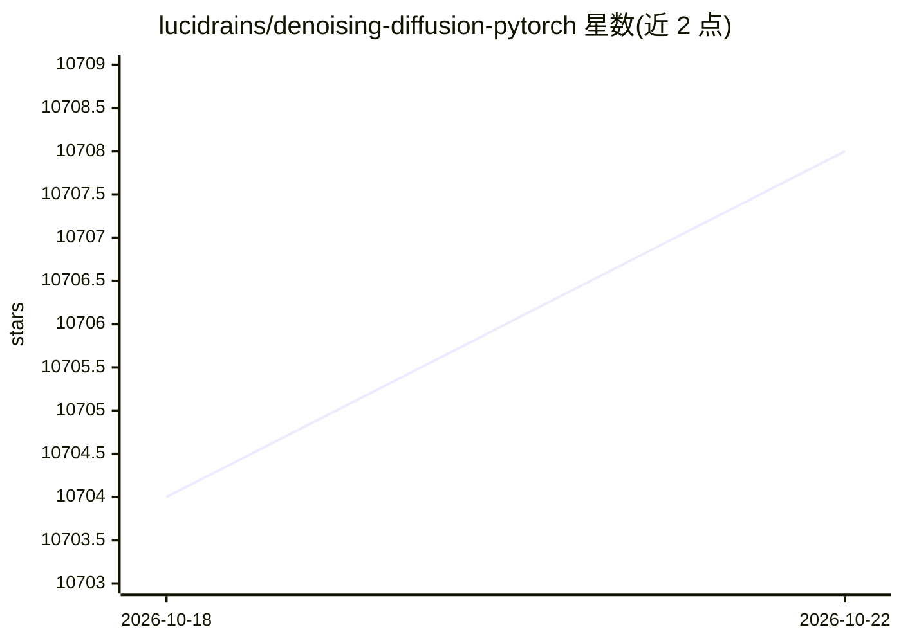

# lucidrains/denoising-diffusion-pytorch

⭐ 10,711 · Python · MIT · 推送 2026-09-29 · [GitHub](https://github.com/lucidrains/denoising-diffusion-pytorch) · 个人维护

**PyTorch 版去噪扩散概率模型（DDPM）实现库**

用 PyTorch 实现去噪扩散概率模型（DDPM）：通过去噪分数匹配估计数据分布梯度，再用 Langevin 采样生成样本。提供 Unet、GaussianDiffusion 核心组件与 Trainer 训练类（传入文件夹与图像尺寸即可训练），支持 1D 序列扩散、XMWrapper 多候选损失、基于 🤗 Accelerator 的多 GPU 训练。样本与 checkpoint 定期写入 ./results。以 pip 包与源码两种形式提供，面向扩散模型研究与实验。

## 筛选速览

| 维度 | 判定 | 备注 |
|---|---|---|
| AI 角色 | `ai-native` | 本体是模型或模型工具 |
| 许可风险 | `permissive` | MIT |
| 部署形态 | `library` | 以包/库形式分发 |
| 模型依赖 | — | README 未给出锁定关系 |
| 硬件要求 | — | 无带数字的原话,不猜 |
| 安装摩擦 | `low` | 无编译、无系统依赖或容器化 |
| 成熟度 | — | 结构信号不足 |

## 能力要点

- Unet + GaussianDiffusion 核心组件与开箱即用的 Trainer 训练类
- 1D 序列版本（Unet1D/Trainer1D/Dataset1D）
- XMWrapper 支持 Explorative Modeling 多候选损失训练
- 经 🤗 Accelerator CLI 的多 GPU 训练

## 适用场景

- 在自己的图像数据集上训练扩散生成模型
- 复现或实验 DDPM 及其后续改进技术
- 对 1D 序列数据做扩散建模

## 场景标签

`图像生成` · 领域:内容生成

## 证据(README 行号)

> L5: Implementation of Denoising Diffusion Probabilistic Model in Pytorch. It is a new approach to generative modeling th
> L34: Or, if you simply want to pass in a folder name and the desired image dimensions, you can use the `Trainer` class t

## 星数曲线

2026-10-18 10,704 → 2026-10-22 10,708（+4）

---
*卡片 v1 · prompt 1.4 · 生成 2026-10-20 · 置信度 high · 依据 README sha `62c3f66cbe04` · [字段定义](../../DATASET.md)*
