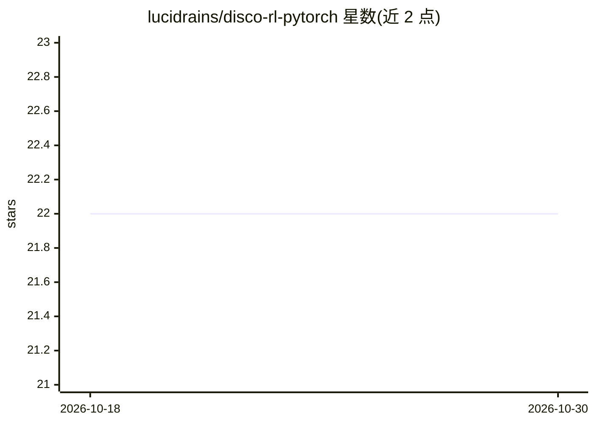

# lucidrains/disco-rl-pytorch

⭐ 22 · Python · MIT · 推送 2026-10-20 · [GitHub](https://github.com/lucidrains/disco-rl-pytorch) · 个人维护

**DiscoRL（DeepMind 强化学习算法发现）的 PyTorch 复现**

对 DeepMind 论文 Discovering state-of-the-art reinforcement learning algorithms（David Silver 等人）的 PyTorch 实现与探索，属于强化学习/元学习方向的代码复现仓库。README 目前仅包含项目说明与论文引用（bibtex），未展示安装或使用方式，标题中标注 wip 表示仍在开发中。面向关注前沿强化学习算法的研究者与开发者。

## 筛选速览

| 维度 | 判定 | 备注 |
|---|---|---|
| AI 角色 | `ai-native` | 本体是模型或模型工具 |
| 许可风险 | `permissive` | MIT |
| 部署形态 | `None` |  |
| 模型依赖 | — | README 未给出锁定关系 |
| 硬件要求 | — | 无带数字的原话,不猜 |
| 安装摩擦 | `low` | 无编译、无系统依赖或容器化 |
| 成熟度 | `idea` | |

## 能力要点

- DiscoRL（Oh et al. 2025）的 PyTorch 实现
- 对'发现 SOTA 强化学习算法'这一工作的探索
- README 附论文 bibtex 引用

## 适用场景

- 复现与研究 DiscoRL 论文中的算法发现方法
- 在自有任务上实验所发现的 RL 算法

## 场景标签

`强化学习` · 领域:训练与推理

## 证据(README 行号)

> L3: ## DiscoRL - Pytorch (wip)
> L5: Implementation and explorations into Discovering state-of-the-art reinforcement learning algorithms (DiscoRL), David

## 星数曲线

2026-10-18 22 → 2026-10-30 22（+0）

---
*卡片 v1 · prompt 1.4 · 生成 2026-10-27 · 置信度 mid · 依据 README sha `1c2a1857164a` · [字段定义](../../DATASET.md)*
