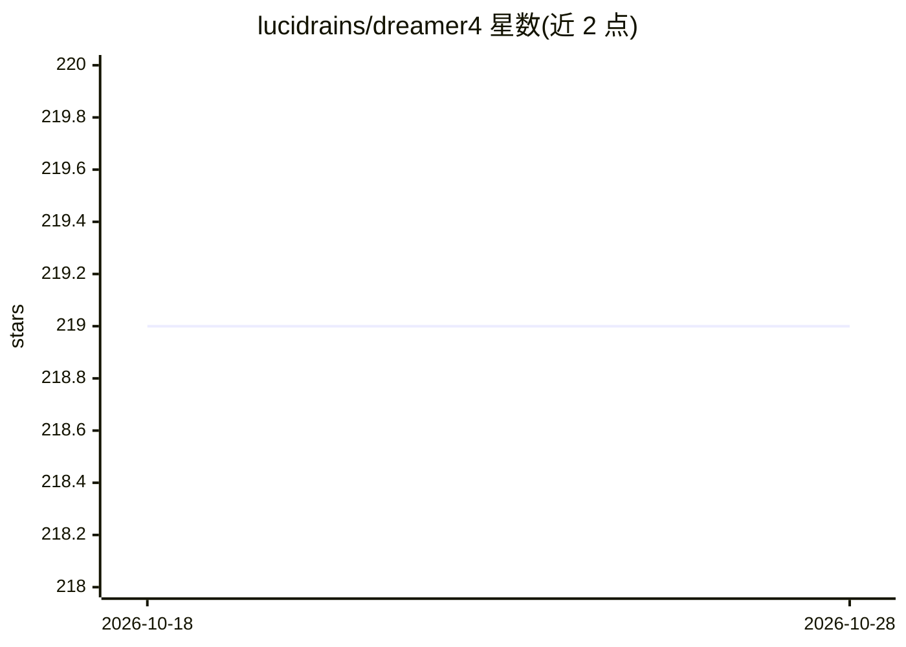

# lucidrains/dreamer4

⭐ 219 · Python · MIT · 推送 2026-10-25 · [GitHub](https://github.com/lucidrains/dreamer4) · 个人维护

**Dreamer 4 世界模型与视频 tokenizer 的 PyTorch 实现，供强化学习研究者使用**

对 Danijar Hafner 等人 Dreamer 系列最新工作（Training Agents Inside of Scalable World Models）的开源实现：提供视频 tokenizer 与 dynamics 世界模型两类可训练组件，支持连续/离散动作条件训练，附带 CLI 训练命令、Python 加载 checkpoint 接口，以及 HalfCheetah-v4 连续控制、Toy Snake、Moving MNIST 三个示例，可通过 dreamer4 serve-world-model 在浏览器中交互查看世界模型。以 pip 包形式提供，面向模型式强化学习方向的研究者与开发者。

## 筛选速览

| 维度 | 判定 | 备注 |
|---|---|---|
| AI 角色 | `ai-native` | 本体是模型或模型工具 |
| 许可风险 | `permissive` | MIT |
| 部署形态 | `library` | 以包/库形式分发 |
| 模型依赖 | — | README 未给出锁定关系 |
| 硬件要求 | — | 无带数字的原话,不猜 |
| 安装摩擦 | `low` | 无编译、无系统依赖或容器化 |
| 成熟度 | — | 结构信号不足 |

## 能力要点

- 提供 VideoTokenizer 与 DynamicsWorldModel 两个核心可训练组件
- 支持连续/离散动作条件（condition_on_actions）的世界模型训练
- CLI 训练命令与浏览器可视化 serve-world-model
- 附带 HalfCheetah-v4、Toy Snake、Moving MNIST 训练示例脚本

## 适用场景

- 在自有视频数据上训练动作条件的世界模型
- 复现 Dreamer 4 系列的 tokenizer 与 dynamics 训练流程
- 在 HalfCheetah 连续控制任务上做基于想象力的 RL 实验

## 场景标签

`强化学习` `模型训练` · 领域:训练与推理

## 证据(README 行号)

> L5: Implementation of Danijar's latest iteration for his Dreamer line of work
> L34: import torch

## 星数曲线

2026-10-18 219 → 2026-10-28 219（+0）

---
*卡片 v1 · prompt 1.4 · 生成 2026-10-22 · 置信度 high · 依据 README sha `7856bd03d9bc` · [字段定义](../../DATASET.md)*
