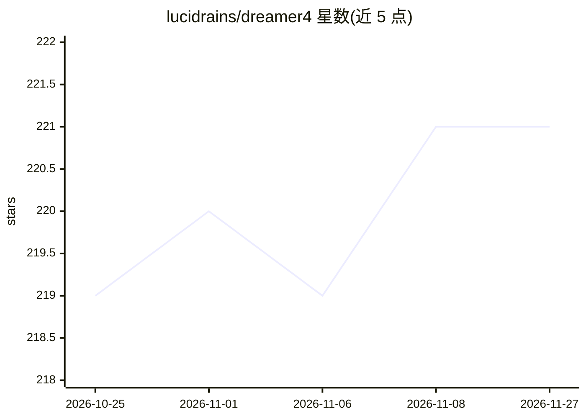

# lucidrains/dreamer4

⭐ 221 · Python · MIT · 推送 2026-11-24 · [GitHub](https://github.com/lucidrains/dreamer4) · 个人维护

**面向研究者的 Dreamer 系列世界模型 PyTorch 实现**

Danijar Hafner Dreamer 系列工作最新迭代的 PyTorch 实现，提供 VideoTokenizer 与 DynamicsWorldModel 两个核心组件，可从视频数据训练视频分词器与动作条件化的动力学世界模型，并支持加载 checkpoint 生成。提供 pip 安装、CLI 训练命令（train-video-tokenizer / train-dynamics / serve-world-model）与浏览器交互界面，附 HalfCheetah 连续控制想象强化学习、Toy Snake、Moving MNIST 三个训练示例。面向研究者的 Discord 协作频道，README 以致谢贡献者与大量引用文献为主。

## 筛选速览

| 维度 | 判定 | 备注 |
|---|---|---|
| AI 角色 | `ai-native` | 本体是模型或模型工具 |
| 许可风险 | `permissive` | MIT |
| 部署形态 | `library` | 以包/库形式分发 |
| 模型依赖 | — | README 未给出锁定关系 |
| 硬件要求 | — | 无带数字的原话,不猜 |
| 安装摩擦 | `low` | 无编译、无系统依赖或容器化 |
| 成熟度 | — | 结构信号不足 |

## 能力要点

- 提供 VideoTokenizer 与 DynamicsWorldModel 两个核心组件及 checkpoint 加载
- CLI 训练视频分词器与动作条件化动力学模型（连续/离散动作 .action.npy）
- serve-world-model 可在浏览器中与训练好的世界模型交互
- 附 HalfCheetah-v4 想象强化学习与 Moving MNIST 训练脚本

## 适用场景

- 从视频数据训练动作条件化的世界模型
- 在想象空间中对连续控制任务（HalfCheetah）做强化学习
- 复现并研究 Dreamer 系列世界模型方法

## 场景标签

`强化学习` · 领域:训练与推理

## 证据(README 行号)

> L35: from dreamer4 import VideoTokenizer, DynamicsWorldModel
> L90: For those interested in continuous control from raw observation states, there now exists a working example of `Half

## 星数曲线

2026-10-25 219 → 2026-11-27 221（+2）

---
*卡片 v1 · prompt 1.4 · 生成 2026-11-25 · 置信度 high · 依据 README sha `31aa1f5248ba` · [字段定义](../../DATASET.md)*
