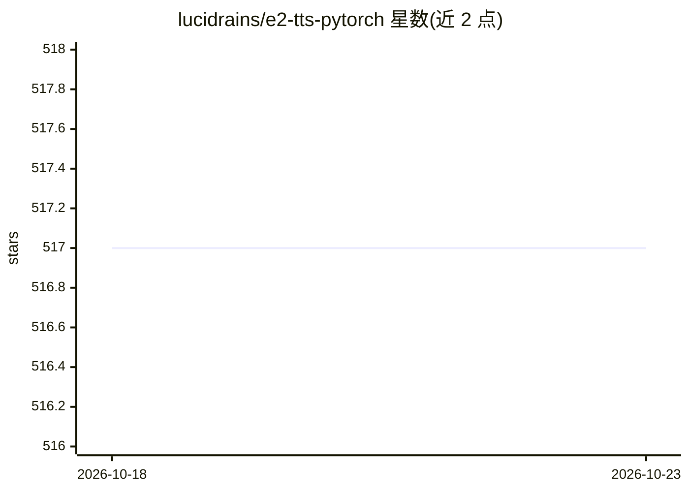

# lucidrains/e2-tts-pytorch

⭐ 517 · Python · MIT · 推送 2025-12-20 · [GitHub](https://github.com/lucidrains/e2-tts-pytorch) · 个人维护

**E2-TTS 零样本文本转语音的 PyTorch 实现**

对论文《Embarrassingly Easy Fully Non-Autoregressive Zero-Shot TTS》的 PyTorch 复现实现，供研究者训练和运行 E2-TTS 语音合成模型。与论文的差异在于采用文本与音频的多流 transformer，并在每个 transformer 块按 E2 方式做条件注入；另含文本插值到音频长度作为条件的改进路径（interpolated_text = True 可开启）。以 pip 包形式提供，README 给出 Python 调用示例，致谢部分记录了多个社区端到端训练与多语言（英中）数据集的成功复现结果。

## 筛选速览

| 维度 | 判定 | 备注 |
|---|---|---|
| AI 角色 | `ai-native` | 本体是模型或模型工具 |
| 许可风险 | `permissive` | MIT |
| 部署形态 | `library` | 以包/库形式分发 |
| 模型依赖 | — | README 未给出锁定关系 |
| 硬件要求 | — | 无带数字的原话,不猜 |
| 安装摩擦 | `low` | 无编译、无系统依赖或容器化 |
| 成熟度 | — | 结构信号不足 |

## 能力要点

- E2-TTS 全非自回归零样本 TTS 的 PyTorch 实现
- 采用文本/音频多流 transformer，逐块条件注入（与论文的差异）
- 可选 interpolated_text 路径：文本插值到音频长度做条件
- 社区已验证端到端训练与英中多语言数据集复现

## 适用场景

- 在 PyTorch 中训练 E2-TTS 语音合成模型
- 复现或改进非自回归零样本 TTS 方法
- 基于多流 transformer 结构做 TTS 研究实验

## 场景标签

`语音合成` · 领域:内容生成

## 证据(README 行号)

> L5: Implementation of E2-TTS, Embarrassingly Easy Fully Non-Autoregressive Zero-Shot TTS, in Pytorch
> L7: The repository differs from the paper in that it uses a multistream transformer for text and audio, with conditionin

## 星数曲线

2026-10-18 517 → 2026-10-23 517（+0）

---
*卡片 v1 · prompt 1.4 · 生成 2026-10-21 · 置信度 high · 依据 README sha `1d6485d3351f` · [字段定义](../../DATASET.md)*
