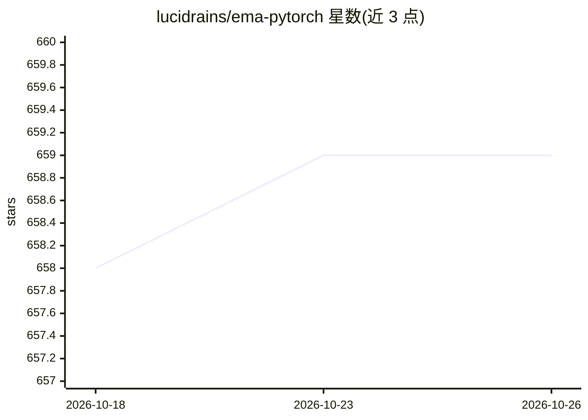

# lucidrains/ema-pytorch

⭐ 659 · Python · MIT · 推送 2026-07-31 · [GitHub](https://github.com/lucidrains/ema-pytorch) · 个人维护

**PyTorch 模型指数移动平均（EMA）追踪库**

为 PyTorch 模型维护指数移动平均（EMA）副本的 Python 库：在训练过程中更新 EMA 参数，支持 Karras 等人提出的 post-hoc 合成 EMA（PostHocEMA）、Switch EMA 的周期性模型更新选项，以及面向嵌套模块树的目标表示路由（EMAModuleWrapper），可把 EMA 子模块输出注入在线子模块的 forward 关键字参数，适配自监督学习（含多视图 SSL 的 student/teacher 输入）。通过 pip 安装，供深度学习模型训练使用。

## 筛选速览

| 维度 | 判定 | 备注 |
|---|---|---|
| AI 角色 | `ai-ecosystem` | LLM/agent 周边工具 |
| 许可风险 | `permissive` | MIT |
| 部署形态 | `library` | 以包/库形式分发 |
| 模型依赖 | — | README 未给出锁定关系 |
| 硬件要求 | — | 无带数字的原话,不猜 |
| 安装摩擦 | `low` | 无编译、无系统依赖或容器化 |
| 成熟度 | — | 结构信号不足 |

## 能力要点

- 训练中维护模型 EMA 副本并可调用 EMA 模型
- PostHocEMA 实现 Karras 等人的事后合成 EMA
- Switch EMA 选项（update_model_with_ema_every）
- EMAModuleWrapper 支持嵌套模块树的目标表示路由与多视图 SSL

## 适用场景

- 训练扩散模型等深度网络时维护 EMA 权重
- 自监督学习中将 teacher（EMA）输出传递给 student 子模块
- 复现论文中的 post-hoc EMA 与 Switch EMA 实验

## 场景标签

`模型训练` · 领域:训练与推理

## 证据(README 行号)

> L3: A simple way to keep track of an Exponential Moving Average (EMA) version of your pytorch model
> L15: from ema_pytorch import EMA

## 星数曲线

2026-10-18 658 → 2026-10-26 659（+1）

---
*卡片 v1 · prompt 1.4 · 生成 2026-10-21 · 置信度 high · 依据 README sha `298c57e011b4` · [字段定义](../../DATASET.md)*
