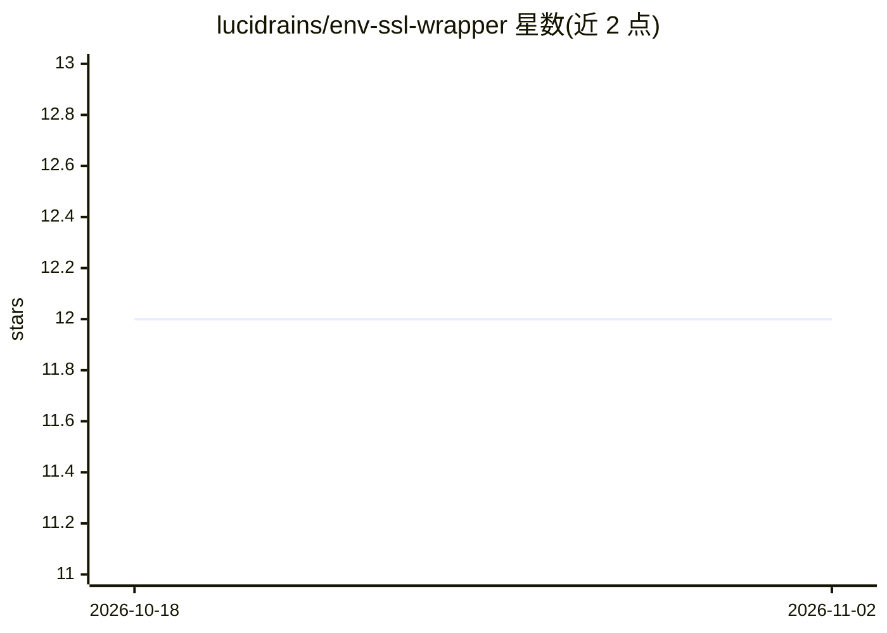

# lucidrains/env-ssl-wrapper

⭐ 12 · Python · MIT · 推送 2026-11-01 · [GitHub](https://github.com/lucidrains/env-ssl-wrapper) · 个人维护

**为强化学习仿真环境提供 torch 原生统一封装的研究库**

Python 库，将 mujoco warp、isaac sim、pybullet、gymnasium、dm_control、robosuite、pufferlib 等多种仿真环境封装为统一的 torch 原生接口。提供研究型封装器：状态指数滑动平均的记忆轨迹（Memory Trace）、基于 Welford 统计的运行均值/方差状态归一化（支持 live/deferred/frozen 三种更新模式与 torchrun 分布式全归约）、开环动作分块（含块内奖励聚合、逐步 trace、critic 侧滑动窗口与填充掩码）。各封装器可组合使用，附 PPO 基准脚本。

## 筛选速览

| 维度 | 判定 | 备注 |
|---|---|---|
| AI 角色 | `ai-ecosystem` | LLM/agent 周边工具 |
| 许可风险 | `permissive` | MIT |
| 部署形态 | `library` | 以包/库形式分发 |
| 模型依赖 | — | README 未给出锁定关系 |
| 硬件要求 | — | 无带数字的原话,不猜 |
| 安装摩擦 | `low` | 无编译、无系统依赖或容器化 |
| 成熟度 | — | 结构信号不足 |

## 能力要点

- 一行代码将多种仿真环境转为统一的 torch 原生接口
- Welford 精确统计的状态归一化，支持 live/deferred/frozen 与分布式 all-reduce
- 开环动作分块：块级奖励聚合、逐步 trace、critic 侧窗口与有效掩码
- 封装器可经 compose_env 组合，附 PPO 基准与分布式测试脚本

## 适用场景

- 让同一套 RL 训练代码跨多种仿真器运行
- 在 POMDP 任务中为状态附加 EMA 记忆特征
- 分布式训练中保持各 rank 状态归一化统计一致
- 实现动作分块的策略/critic 训练流水线

## 场景标签

`强化学习` · 领域:训练与推理

## 证据(README 行号)

> L3: One line turns any simulator's environment — mujoco warp, isaac sim, pybullet, gymnasium, pufferlib, dm_control, rob
> L31: ## Research Wrappers

## 星数曲线

2026-10-18 12 → 2026-11-02 12（+0）

---
*卡片 v1 · prompt 1.4 · 生成 2026-11-01 · 置信度 high · 依据 README sha `05e1fd14db00` · [字段定义](../../DATASET.md)*
