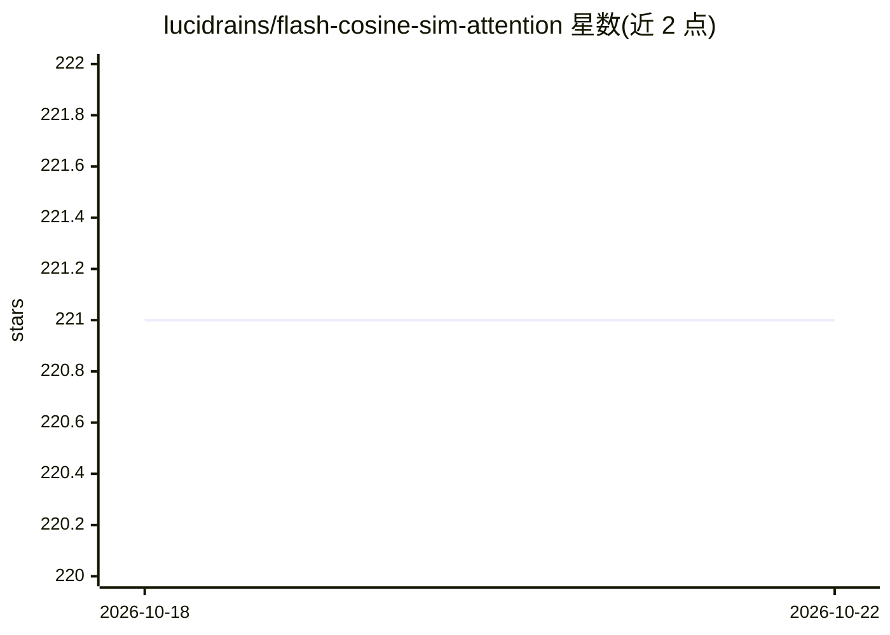

# lucidrains/flash-cosine-sim-attention

⭐ 221 · Python · MIT · 推送 2026-08-24 · [GitHub](https://github.com/lucidrains/flash-cosine-sim-attention) · 个人维护

**面向研究者的融合余弦相似度注意力 CUDA 核实现**

lucidrains 维护的 PyTorch 库，以 Flash Attention 风格实现融合的余弦相似度注意力：对 query 与 key 做 l2 归一化后无需跟踪行最大值即可数值稳定，支持自注意、交叉注意、因果掩码、变长序列、单头 KV 等用法，覆盖 f32 多种头维度。README 标注 wip，并提示 FID 实验结果存在争议，作者建议谨慎使用。通过 pip 安装，CUDA 核需 setup.py install 编译，附基准测试与 Enwik8 小型 GPT 训练示例。

## 筛选速览

| 维度 | 判定 | 备注 |
|---|---|---|
| AI 角色 | `ai-ecosystem` | LLM/agent 周边工具 |
| 许可风险 | `permissive` | MIT |
| 部署形态 | `library` | 以包/库形式分发 |
| 模型依赖 | — | README 未给出锁定关系 |
| 硬件要求 | — | 无带数字的原话,不猜 |
| 安装摩擦 | `medium` | 含编译或系统依赖之一 |
| 成熟度 | `idea` | |

## 能力要点

- l2 归一化 query/key 免除行最大值跟踪的融合注意力 CUDA 核
- 支持自注意/交叉注意/因果/变长序列/单头 KV/额外注意力偏置
- 支持 f32 头维度 16/32/64/96/128，含仅推理的 CPU 内存高效版本
- 附 GTX 2080 Ti 与 A100 基准及 Enwik8 训练脚本

## 适用场景

- 在长序列（>2048）自回归训练中替代常规注意力以节省显存
- 在文本到图像等生成模型中实验余弦相似度注意力
- 对注意力核做前向/反向基准测试

## 场景标签

 · 领域:深度学习/模型组件

## 证据(README 行号)

> L7: Implementation of fused cosine similarity attention in the same style as Flash Attention. The observation is that by
> L143: - [x] bring in a CPU memory efficient version (only for inference, as training does not make sense) using just pla
> L304: $ python train.py --seq-len 8192 --use-cuda-kernel

## 星数曲线

2026-10-18 221 → 2026-10-22 221（+0）

---
*卡片 v1 · prompt 1.4 · 生成 2026-10-22 · 置信度 high · 依据 README sha `e15d3f0bac86` · [字段定义](../../DATASET.md)*
