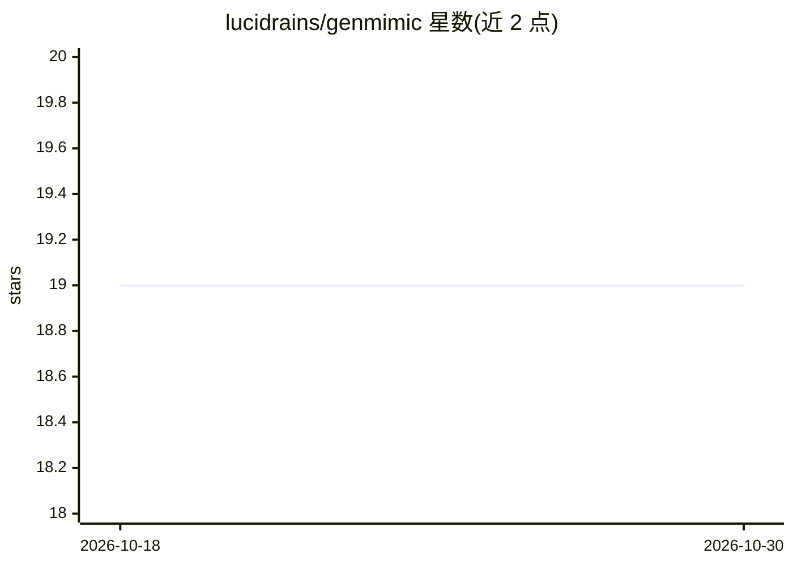

# lucidrains/genmimic

⭐ 19 · Python · MIT · 推送 2026-09-01 · [GitHub](https://github.com/lucidrains/genmimic) · 个人维护

**GenMimic 论文的 PyTorch 实现：生成人类视频到机器人轨迹**

lucidrains 对论文《From Generated Human Videos to Physically Plausible Robot Trajectories》的 PyTorch 复现实现，方向为机器人运动模仿：从生成的人类视频推导物理上合理的机器人运动轨迹。通过 pip 安装 genmimic-pytorch，以 Python API（实例化 GenMimic 类）形式使用。README 标注 wip（进行中），除安装与基本用法外仅提供论文引用信息，无训练细节或示例工程说明。

## 筛选速览

| 维度 | 判定 | 备注 |
|---|---|---|
| AI 角色 | `ai-native` | 本体是模型或模型工具 |
| 许可风险 | `permissive` | MIT |
| 部署形态 | `library` | 以包/库形式分发 |
| 模型依赖 | — | README 未给出锁定关系 |
| 硬件要求 | — | 无带数字的原话,不猜 |
| 安装摩擦 | `low` | 无编译、无系统依赖或容器化 |
| 成熟度 | `idea` | |

## 能力要点

- GenMimic 论文的 PyTorch 复现实现
- pip 安装、Python API 调用（from genmimic_pytorch import GenMimic）
- 方向为生成人类视频到物理合理的机器人轨迹

## 适用场景

- 复现或研究 GenMimic 论文方法
- 机器人运动模仿相关实验的原型代码基础

## 场景标签

 · 领域:机器人/具身智能

## 证据(README 行号)

> L1: ## GenMimic (wip)
> L3: Implementation of GenMimic, From Generated Human Videos to Physically Plausible Robot Trajectories, in Pytorch

## 星数曲线

2026-10-18 19 → 2026-10-30 19（+0）

---
*卡片 v1 · prompt 1.4 · 生成 2026-10-29 · 置信度 high · 依据 README sha `ee77e1e9f83b` · [字段定义](../../DATASET.md)*
