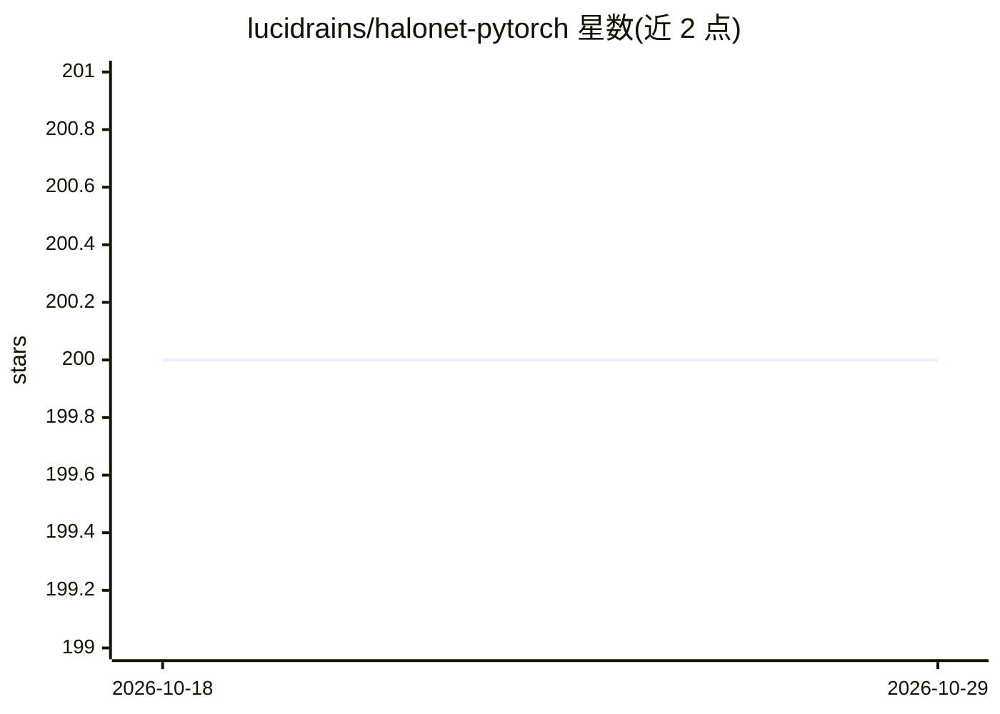

# lucidrains/halonet-pytorch

⭐ 200 · Python · MIT · 推送 2026-09-18 · [GitHub](https://github.com/lucidrains/halonet-pytorch) · 个人维护

**HaloNet 注意力层的 PyTorch 实现，供视觉骨干网络使用**

论文 Scaling Local Self-Attention For Parameter Efficient Visual Backbones 中 HaloAttention 层的 PyTorch 复现，作者声明仓库仅包含该注意力层本身。以 Python 包形式通过 pip 安装，用法为从 halonet_pytorch 导入 HaloAttention 模块并在 PyTorch 代码中调用。面向需要在视觉模型中集成局部自注意力机制的开发者。

## 筛选速览

| 维度 | 判定 | 备注 |
|---|---|---|
| AI 角色 | `ai-native` | 本体是模型或模型工具 |
| 许可风险 | `permissive` | MIT |
| 部署形态 | `library` | 以包/库形式分发 |
| 模型依赖 | — | README 未给出锁定关系 |
| 硬件要求 | — | 无带数字的原话,不猜 |
| 安装摩擦 | `low` | 无编译、无系统依赖或容器化 |
| 成熟度 | — | 结构信号不足 |

## 能力要点

- 实现论文中的 HaloAttention 局部自注意力层
- pip 安装，导入 HaloAttention 模块即用
- 附论文引用（Vaswani 等 2021）

## 适用场景

- 在视觉骨干网络中替换卷积为注意力层
- 复现或实验论文中的局部自注意力机制

## 场景标签

 · 领域:深度学习/计算机视觉

## 证据(README 行号)

> L5: Implementation of the Attention layer from the paper, Scaling Local Self-Attention For Parameter Efficient Visual Ba
> L16: import torch

## 星数曲线

2026-10-18 200 → 2026-10-29 200（+0）

---
*卡片 v1 · prompt 1.4 · 生成 2026-10-22 · 置信度 high · 依据 README sha `22f18c7f6d56` · [字段定义](../../DATASET.md)*
