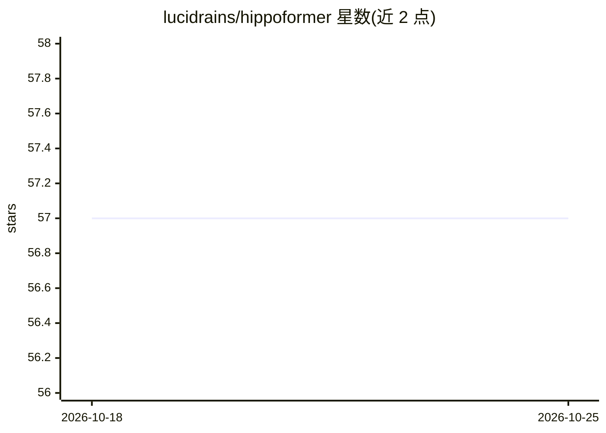

# lucidrains/hippoformer

⭐ 57 · Python · MIT · 推送 2026-08-04 · [GitHub](https://github.com/lucidrains/hippoformer) · 个人维护

**Hippoformer 的非官方实现：海马体启发的空间记忆与 Transformer 结合**

由 lucidrains 维护的论文非官方 PyTorch 实现项目，对应论文《Hippoformer: Integrating Hippocampus-inspired Spatial Memory with Transformers》（匿名，2025）。README 自标注 wip（进行中）。内容仅包含项目标题与两条 BibTeX 引用（Hippoformer 论文及 Grid Cells Are Ubiquitous in Neural Networks），未见安装说明、使用方法或依赖列表。面向关注神经记忆机制模型的开发者与研究者。

## 筛选速览

| 维度 | 判定 | 备注 |
|---|---|---|
| AI 角色 | `ai-native` | 本体是模型或模型工具 |
| 许可风险 | `permissive` | MIT |
| 部署形态 | `None` |  |
| 模型依赖 | — | README 未给出锁定关系 |
| 硬件要求 | — | 无带数字的原话,不猜 |
| 安装摩擦 | `low` | 无编译、无系统依赖或容器化 |
| 成熟度 | `idea` | |

## 能力要点

- 对应 2025 年 Hippoformer 论文的非官方实现
- 海马体启发的空间记忆与 Transformer 结合
- README 标注 wip，处于开发中状态

## 适用场景

- 跟踪论文的第三方代码实现进展
- 研究生成式记忆架构（如记忆 token 与注意力机制）的参考代码

## 场景标签

 · 领域:深度学习/模型实现

## 证据(README 行号)

> L3: ## Hippoformer (wip)
> L5: Unofficial implementation of Hippoformer, Integrating Hippocampus-inspired Spatial Memory with Transformers

## 星数曲线

2026-10-18 57 → 2026-10-25 57（+0）

---
*卡片 v1 · prompt 1.4 · 生成 2026-10-24 · 置信度 low · 依据 README sha `dfe9f81acc3b` · [字段定义](../../DATASET.md)*
