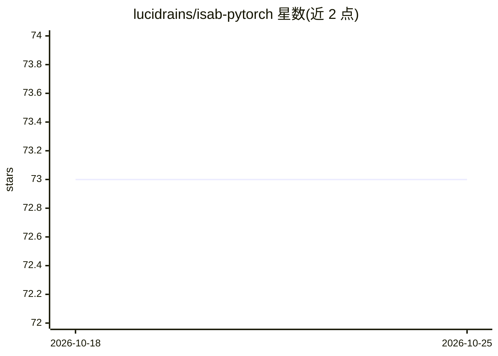

# lucidrains/isab-pytorch

⭐ 73 · Python · MIT · 推送 2026-06-08 · [GitHub](https://github.com/lucidrains/isab-pytorch) · 个人维护

**Set Transformers 论文 ISAB 模块的 PyTorch 实现**

实现 (Induced) Set Attention Block（ISAB），出自 Set Transformers 论文：通过 m 个可学习的 inducing points（latents）将注意力复杂度从 O(n²) 降至 O(mn)。以 Python 包提供，pip 安装；支持自行设定 latents 数量或外部传入 latents，支持 inverted_attention 模式（softmax 沿 query 维，类似 slot attention）。README 引用 Set Transformer、Flamingo、Slot Attention、Inverted Attention 论文；提及 ISAB 已被扩散模型去噪生成领域采用。

## 筛选速览

| 维度 | 判定 | 备注 |
|---|---|---|
| AI 角色 | `ai-ecosystem` | LLM/agent 周边工具 |
| 许可风险 | `permissive` | MIT |
| 部署形态 | `library` | 以包/库形式分发 |
| 模型依赖 | — | README 未给出锁定关系 |
| 硬件要求 | — | 无带数字的原话,不猜 |
| 安装摩擦 | `low` | 无编译、无系统依赖或容器化 |
| 成熟度 | — | 结构信号不足 |

## 能力要点

- ISAB 注意力模块实现，复杂度 O(n²) 降至 O(mn)
- latents 可内部实例化或由外部传入
- 支持 inverted_attention 模式（latents 竞争输入 token）

## 适用场景

- 在集合/置换不变任务中使用 Set Transformer 组件
- 在扩散模型等场景中复用 ISAB 高效注意力
- 研究 slot attention 式的 latents 竞争机制

## 场景标签

 · 领域:深度学习/研究实现

## 证据(README 行号)

> L3: ## Induced Set Attention Block (ISAB) - Pytorch
> L5: A concise implementation of (Induced) Set Attention Block, from the Set Transformers paper. It proposes to reduce at

## 星数曲线

2026-10-18 73 → 2026-10-25 73（+0）

---
*卡片 v1 · prompt 1.4 · 生成 2026-10-24 · 置信度 high · 依据 README sha `563459c9dc8a` · [字段定义](../../DATASET.md)*
