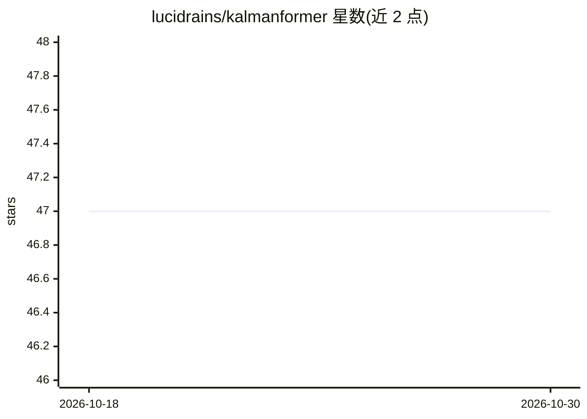

# lucidrains/kalmanformer

⭐ 47 · Python · MIT · 推送 2026-06-02 · [GitHub](https://github.com/lucidrains/kalmanformer) · 个人维护

**用 Transformer 学习 Kalman 增益的状态估计模型实现**

KalmanFormer 论文的 PyTorch 实现：以 Transformer 从数据中直接学习 Kalman 增益，绕开传统卡尔曼滤波器在非线性系统上的限制。以 pip 包形式提供，用法为导入 KalmanFormer 模块配合 torch 使用，README 附使用示例与 BibTeX 引用信息。面向需要状态估计深度学习方法的开发与科研用户。

## 筛选速览

| 维度 | 判定 | 备注 |
|---|---|---|
| AI 角色 | `ai-native` | 本体是模型或模型工具 |
| 许可风险 | `permissive` | MIT |
| 部署形态 | `library` | 以包/库形式分发 |
| 模型依赖 | — | README 未给出锁定关系 |
| 硬件要求 | — | 无带数字的原话,不猜 |
| 安装摩擦 | `low` | 无编译、无系统依赖或容器化 |
| 成熟度 | — | 结构信号不足 |

## 能力要点

- Transformer 从数据直接学习 Kalman 增益
- 针对传统卡尔曼滤波在非线性系统上的限制
- 以 pip 包 kalmanformer 提供，带使用代码示例

## 适用场景

- 非线性系统的状态估计实验
- 复现 KalmanFormer 论文方法
- 作为可学习的滤波模块嵌入 PyTorch 项目

## 场景标签

 · 领域:机器学习/状态估计

## 证据(README 行号)

> L5: Implementation of KalmanFormer.
> L7: The paper proposes learning the Kalman Gain directly from data using Transformers, bypassing the limitations of trad

## 星数曲线

2026-10-18 47 → 2026-10-30 47（+0）

---
*卡片 v1 · prompt 1.4 · 生成 2026-10-25 · 置信度 high · 依据 README sha `3e38c23e2e35` · [字段定义](../../DATASET.md)*
