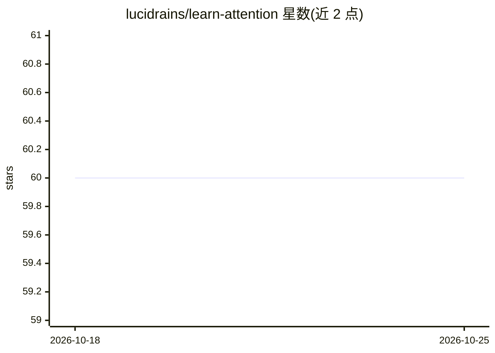

# lucidrains/learn-attention

⭐ 60 · HTML · MIT · 推送 2026-10-20 · [GitHub](https://github.com/lucidrains/learn-attention) · [官网](https://lucidrains.github.io/learn-attention/) · 个人维护

**面向学生的 attention 机制可视化讲解教程仓库**

lucidrains 维护的教学性质仓库（标注 wip），目标是以作者自己的理解方式向学生和 transformer 学习者讲解 attention 机制，试图传达“就这么简单”的直觉。README 目前仅包含描述与三篇论文的 BibTeX 引用：Bahdanau 2014 神经机器翻译对齐、Vaswani 2017《Attention Is All You Need》、Ramsauer 2021 Hopfield Networks。未提供安装、运行或代码使用说明。

## 筛选速览

| 维度 | 判定 | 备注 |
|---|---|---|
| AI 角色 | `ai-knowledge` | 知识聚合/清单类 |
| 许可风险 | `permissive` | MIT |
| 部署形态 | `None` |  |
| 模型依赖 | — | README 未给出锁定关系 |
| 硬件要求 | — | 无带数字的原话,不猜 |
| 安装摩擦 | `low` | 无编译、无系统依赖或容器化 |
| 成熟度 | `idea` | |

## 能力要点

- 以直觉方式讲解 attention 机制的教学仓库
- 引用 Attention Is All You Need 等三篇核心论文
- 自标注 wip（进行中）

## 适用场景

- 学习 transformer 中 attention 机制的概念
- 查阅 attention 相关经典论文引用

## 场景标签

`教程课程` · 领域:学习与行业

## 证据(README 行号)

> L1: ## Learn Attention (wip)
> L3: Sharing how attention appears in my mind's eye, for students and those interested in understanding transformers

## 星数曲线

2026-10-18 60 → 2026-10-25 60（+0）

---
*卡片 v1 · prompt 1.4 · 生成 2026-10-24 · 置信度 mid · 依据 README sha `6ffff3430c24` · [字段定义](../../DATASET.md)*
