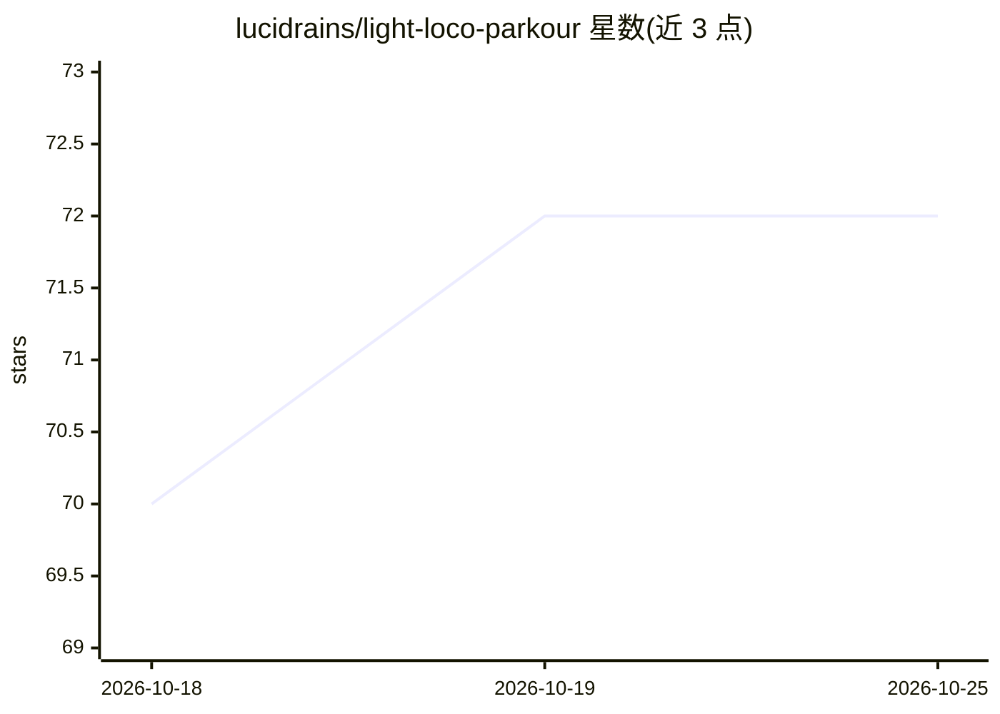

# lucidrains/light-loco-parkour

⭐ 72 · Python · MIT · 推送 2026-10-14 · [GitHub](https://github.com/lucidrains/light-loco-parkour) · 个人维护

**机器人四足感知运动技能的论文官方实现（进行中）**

Light Origins Labs 论文《Light Loco Parkour: Versatile Perceptive Whole-Body Locomotion via Multi-Skill Distillation》的实现仓库，属于足式机器人运动控制/强化学习方向，作者为 Chen, Hongming 等（北京大学相关团队）。README 标注 wip（进行中），当前内容仅含论文引用与多篇相关工作（Multi-Critic Actor Learning、知识蒸馏增强 Behavior Transformer 等）的 BibTeX，尚未给出安装命令、训练脚本或使用说明。面向机器人学与深度学习研究者。

## 筛选速览

| 维度 | 判定 | 备注 |
|---|---|---|
| AI 角色 | `ai-native` | 本体是模型或模型工具 |
| 许可风险 | `permissive` | MIT |
| 部署形态 | `None` |  |
| 模型依赖 | — | README 未给出锁定关系 |
| 硬件要求 | — | 无带数字的原话,不猜 |
| 安装摩擦 | `low` | 无编译、无系统依赖或容器化 |
| 成熟度 | `idea` | |

## 能力要点

- 论文官方实现，标注 wip 状态
- 主题为多技能蒸馏的感知全身运动控制
- README 附带 6 篇相关工作 BibTeX 引用

## 适用场景

- 复现论文的四足机器人跑酷运动控制方法
- 跟踪足式机器人运动学习方向的官方代码进展
- 查阅论文及相关工作引用

## 场景标签

`强化学习` · 领域:训练与推理

## 证据(README 行号)

> L3: ## Light Loco Parkour - (wip)
> L5: Implementation of Light Loco Parkour, Versatile Perceptive Whole-Body Locomotion via Multi-Skill Distillation, out o

## 星数曲线

2026-10-18 70 → 2026-10-25 72（+2）

---
*卡片 v1 · prompt 1.4 · 生成 2026-10-24 · 置信度 mid · 依据 README sha `c6f7abd859e7` · [字段定义](../../DATASET.md)*
