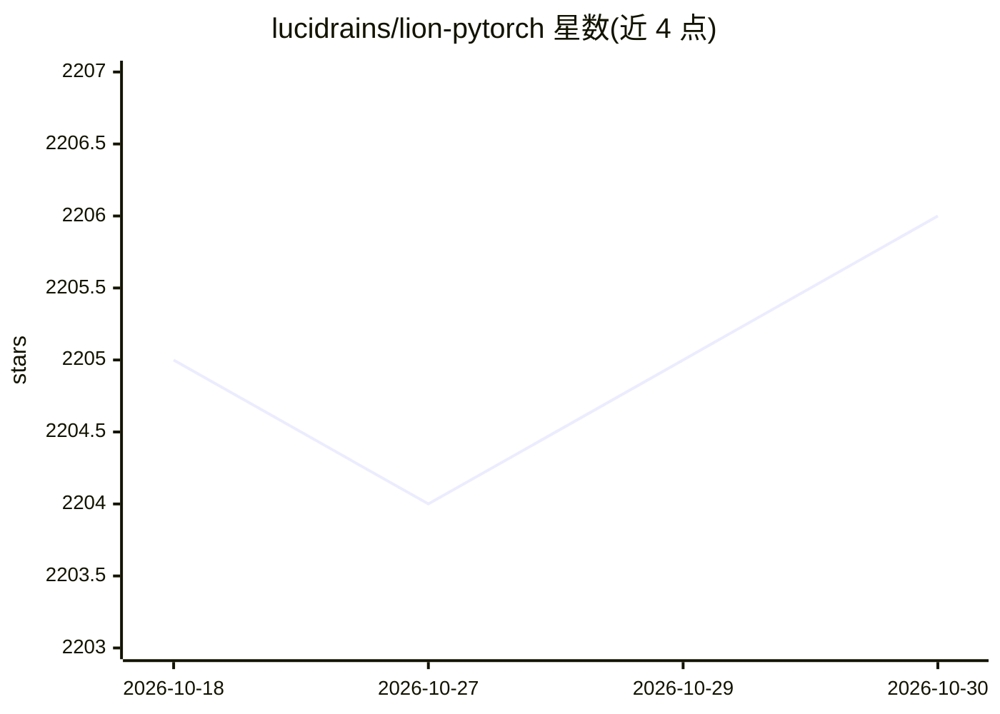

# lucidrains/lion-pytorch

⭐ 2,206 · Python · MIT · 推送 2026-07-09 · [GitHub](https://github.com/lucidrains/lion-pytorch) · 个人维护

**PyTorch 版 Lion 优化器：Google Brain 用遗传算法发现的 Adam 替代**

将 Google Brain 论文中的 Lion（EvoLved Sign Momentum）优化器实现为 PyTorch 库，代码近乎照搬 JAX 原版并做少量修改，供训练深度学习模型时替换 AdamW 使用。README 给出作者建议的超参设置：学习率与解耦权重衰减通常比 AdamW 小/大 3-10 倍，β1=0.9、β2=0.99，并记录多轮实验更新——建议高 batch size（64 以上）场景使用，仍需调参。支持可选 Triton 融合核加速 CUDA 参数更新。

## 筛选速览

| 维度 | 判定 | 备注 |
|---|---|---|
| AI 角色 | `ai-ecosystem` | LLM/agent 周边工具 |
| 许可风险 | `permissive` | MIT |
| 部署形态 | `library` | 以包/库形式分发 |
| 模型依赖 | — | README 未给出锁定关系 |
| 硬件要求 | — | 无带数字的原话,不猜 |
| 安装摩擦 | `medium` | 含编译或系统依赖之一 |
| 成熟度 | — | 结构信号不足 |

## 能力要点

- Lion 优化器的 PyTorch 实现，近乎照搬 JAX 原版并少量修改
- README 整理作者建议的超参规则（lr 为 AdamW 的 1/3-1/10、wd 相应放大）
- 可选 Triton 融合 CUDA 核加速参数更新
- 附论文与 Triton、Cautious Optimizers 等引用文献

## 适用场景

- 深度学习训练中替换 AdamW 优化器试用 Lion
- 高 batch size（≥64）场景下的模型训练实验
- 结合 Triton 融合核在 CUDA 上加速优化器更新

## 场景标签

 · 领域:深度学习/训练优化

## 证据(README 行号)

> L5: 🦁 Lion, Evo**L**ved S**i**gn M**o**me**n**tum, new optimizer discovered by Google Brain that is purportedly better t
> L36: $ pip install lion-pytorch

## 星数曲线

2026-10-18 2,205 → 2026-10-30 2,206（+1）

---
*卡片 v1 · prompt 1.4 · 生成 2026-10-21 · 置信度 high · 依据 README sha `86828bd7b6fc` · [字段定义](../../DATASET.md)*
