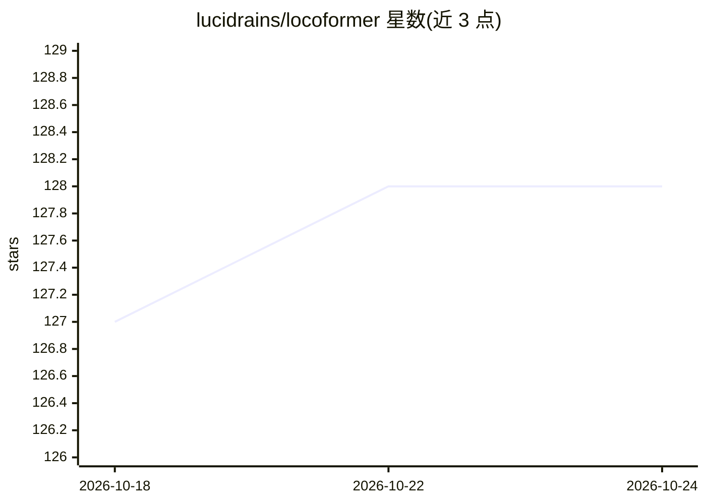

# lucidrains/locoformer

⭐ 128 · Python · MIT · 推送 2026-09-11 · [GitHub](https://github.com/lucidrains/locoformer) · 个人维护

**基于 Transformer-XL 的跨形态机器人运动模型库（wip）**

LocoFormer 的研究代码实现：在仿真中对多种机器人本体（cross-embodiment）施加极端域随机化训练 Transformer-XL，XL 记忆跨越多次试验使机器人在迁移到真实环境时具备上下文内适应能力。以 Python 库形式发布（pip install locoformer），并提供用 PPO 从零训练 Microduck 双足机器人自适应步态的训练脚本，约 2M 步内出现双足行走步态。README 自标注 wip，属进行中项目。

## 筛选速览

| 维度 | 判定 | 备注 |
|---|---|---|
| AI 角色 | `ai-native` | 本体是模型或模型工具 |
| 许可风险 | `permissive` | MIT |
| 部署形态 | `library` | 以包/库形式分发 |
| 模型依赖 | — | README 未给出锁定关系 |
| 硬件要求 | — | 无带数字的原话,不猜 |
| 安装摩擦 | `low` | 无编译、无系统依赖或容器化 |
| 成熟度 | `idea` | |

## 能力要点

- Transformer-XL 跨多次试验的长上下文记忆实现上下文内适应
- cross-embodiment 多本体仿真训练与极端域随机化
- 提供 Microduck 双足 sim-to-real 训练脚本（PPO），支持评估视频与断点续训

## 适用场景

- 研究机器人运动的跨本体泛化与 sim-to-real 迁移
- 复现/训练 Microduck 双足自适应行走步态
- 基于长上下文 Transformer 研究具身适应机制

## 场景标签

`强化学习` · 领域:训练与推理

## 证据(README 行号)

> L7: The gist is they trained a simple Transformer-XL in simulation on robots with many different bodies (cross-embodimen
> L26: You can train an adaptive bipedal walking gait for the Microduck biped robot from scratch using `Locoformer` and PP

## 星数曲线

2026-10-18 127 → 2026-10-24 128（+1）

---
*卡片 v1 · prompt 1.4 · 生成 2026-10-22 · 置信度 high · 依据 README sha `a17bf73b02ae` · [字段定义](../../DATASET.md)*
