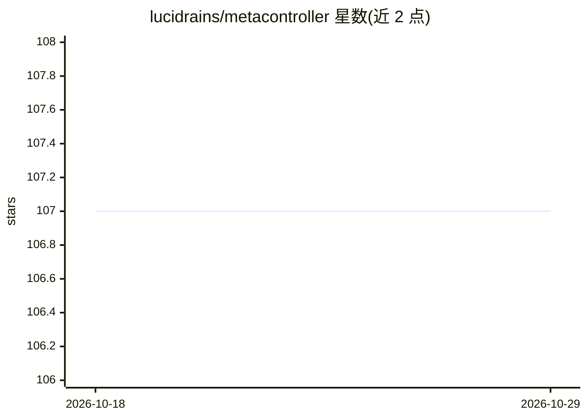

# lucidrains/metacontroller

⭐ 107 · Jupyter Notebook · MIT · 推送 2026-08-14 · [GitHub](https://github.com/lucidrains/metacontroller) · 个人维护

**MetaController 论文的 PyTorch 实现：自回归模型的分层强化学习**

Google Paradigms of Intelligence 团队论文 "Emergent temporal abstractions in autoregressive models enable hierarchical reinforcement learning" 的开源 PyTorch 实现。提供 Transformer 与 MetaController 组件，通过潜在时间抽象实现分层强化学习；用法示例展示 GRPO 训练流程，并支持用进化策略（ES）替换 GRPO 的末段训练。代码在 BabyAI gridworld、PinPad 等环境上有社区贡献的测试与扩展（行为克隆、发现阶段训练、线性探测）。以 pip 包形式安装，面向复现论文与做分层 RL 研究的用户。

## 筛选速览

| 维度 | 判定 | 备注 |
|---|---|---|
| AI 角色 | `ai-native` | 本体是模型或模型工具 |
| 许可风险 | `permissive` | MIT |
| 部署形态 | `library` | 以包/库形式分发 |
| 模型依赖 | — | README 未给出锁定关系 |
| 硬件要求 | — | 无带数字的原话,不猜 |
| 安装摩擦 | `low` | 无编译、无系统依赖或容器化 |
| 成熟度 | — | 结构信号不足 |

## 能力要点

- 实现论文提出的 MetaController，用于自回归模型的分层强化学习
- 支持以进化策略（ES）替代 GRPO 的末段训练
- 提供 Transformer 与 MetaController 的 Python API
- 社区在 BabyAI、PinPad 环境上贡献了测试与训练扩展

## 适用场景

- 复现论文中的分层强化学习实验
- 在 BabyAI/PinPad 等环境上做时间抽象与分层 RL 研究
- 比较 GRPO 与进化策略在潜在动作学习中的效果

## 场景标签

`强化学习` · 领域:训练与推理

## 证据(README 行号)

> L5: Implementation of the MetaController proposed in Emergent temporal abstractions in autoregressive models enable hier
> L33: ```python
> L45: model.meta_controller = meta_controller

## 星数曲线



2026-10-18 107 → 2026-10-29 107（+0）


---
*卡片 v1 · prompt 1.4 · 生成 2026-10-23 · 置信度 high · 依据 README sha `c94cc6ef6deb` · [字段定义](../../DATASET.md)*
