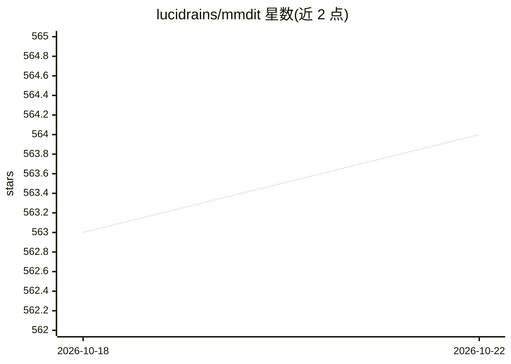

# lucidrains/mmdit

⭐ 564 · Python · MIT · 推送 2026-01-18 · [GitHub](https://github.com/lucidrains/mmdit) · 个人维护

**PyTorch 实现的 MMDiT 层，出自 Stable Diffusion 3**

以 PyTorch 复现 Esser 等人在 Stable Diffusion 3 论文中提出的 MMDiT（多模态 Diffusion Transformer）的单层实现，并扩展到多于两种模态（如图像、音频、文本）的通用版本；另提供一种经学习门控自适应选择注意力权重的变体，思路源自 GigaGAN 的自适应卷积。以 Python 包形式通过 pip 安装，面向构建多模态 Transformer 的深度学习开发者。

## 筛选速览

| 维度 | 判定 | 备注 |
|---|---|---|
| AI 角色 | `ai-native` | 本体是模型或模型工具 |
| 许可风险 | `permissive` | MIT |
| 部署形态 | `library` | 以包/库形式分发 |
| 模型依赖 | — | README 未给出锁定关系 |
| 硬件要求 | — | 无带数字的原话,不猜 |
| 安装摩擦 | `low` | 无编译、无系统依赖或容器化 |
| 成熟度 | — | 结构信号不足 |

## 能力要点

- 复现 Stable Diffusion 3 论文中的 MMDiT 单层结构
- 通用版本支持超过 2 种模态（图像/音频/文本）
- 提供基于学习门控的自适应注意力变体（思路源自 GigaGAN）

## 适用场景

- 在自研多模态模型中使用 MMDiT 结构
- 复现或研究 Stable Diffusion 3 的网络组件
- 实验自适应门控注意力机制

## 场景标签

`多模态` · 领域:感知与多模态

## 证据(README 行号)

> L5: Implementation of a single layer of the MMDiT, proposed by Esser et al. in Stable Diffusion 3, in Pytorch
> L7: Besides a straight reproduction, will also generalize to > 2 modalities, as I can envision an MMDiT for images, audi

## 星数曲线

2026-10-18 563 → 2026-10-22 564（+1）

---
*卡片 v1 · prompt 1.4 · 生成 2026-10-21 · 置信度 high · 依据 README sha `09cd4993d967` · [字段定义](../../DATASET.md)*
