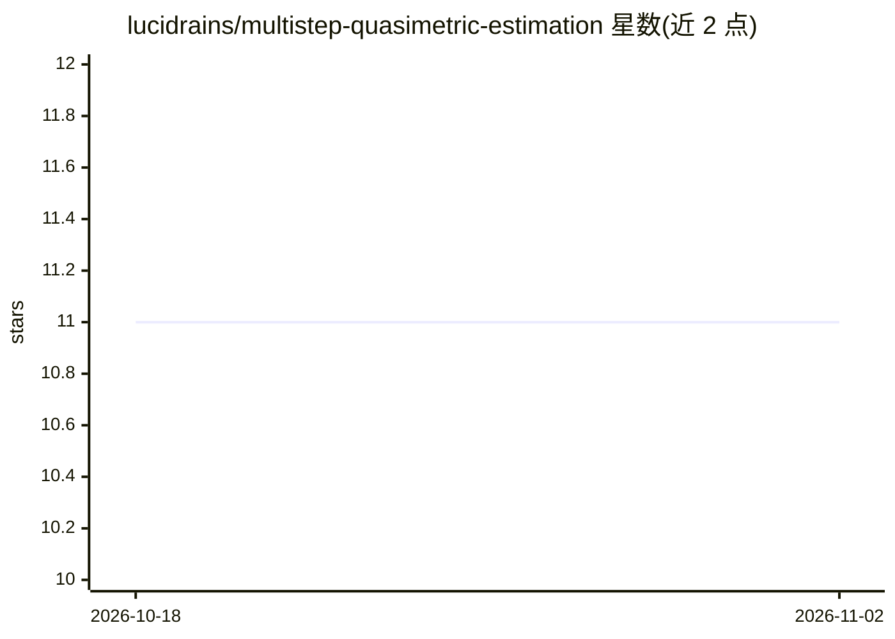

# lucidrains/multistep-quasimetric-estimation

⭐ 11 · Python · MIT · 推送 2026-09-23 · [GitHub](https://github.com/lucidrains/multistep-quasimetric-estimation) · 个人维护

**Multistep Quasimetric Estimation 论文的 PyTorch 探索性实现**

lucidrains 维护的 PyTorch 库，对 Berkeley 的 Zheng 等人提出的目标条件强化学习方法 Multistep Quasimetric Estimation 做探索与实现。方法结合拟度量距离空间、后继表示、动作不变性损失等设计，用于可扩展的目标条件强化学习。通过 pip install MQE 安装，README 提供代码使用示例，并引用原始论文与 Metric Residual Networks 论文。

## 筛选速览

| 维度 | 判定 | 备注 |
|---|---|---|
| AI 角色 | `ai-native` | 本体是模型或模型工具 |
| 许可风险 | `permissive` | MIT |
| 部署形态 | `library` | 以包/库形式分发 |
| 模型依赖 | — | README 未给出锁定关系 |
| 硬件要求 | — | 无带数字的原话,不猜 |
| 安装摩擦 | `low` | 无编译、无系统依赖或容器化 |
| 成熟度 | — | 结构信号不足 |

## 能力要点

- 拟度量学习结合后继表示的 PyTorch 实现
- 包含动作不变性损失等损失设计
- pip 可安装，附带使用示例

## 适用场景

- 复现 Multistep Quasimetric Learning 论文方法
- 目标条件强化学习中学习拟度量距离
- 在此基础上做研究实验扩展

## 场景标签

`强化学习` · 领域:训练与推理

## 证据(README 行号)

> L5: Exploration and eventually practical implementation for the Multistep Quasimetric Estimation proposed by Zheng et al
> L7: This paper is a coming together of a few ideas: quasimetric distance spaces and successor representations, along wit

## 星数曲线

2026-10-18 11 → 2026-11-02 11（+0）

---
*卡片 v1 · prompt 1.4 · 生成 2026-11-02 · 置信度 high · 依据 README sha `c5cf11229bb9` · [字段定义](../../DATASET.md)*
