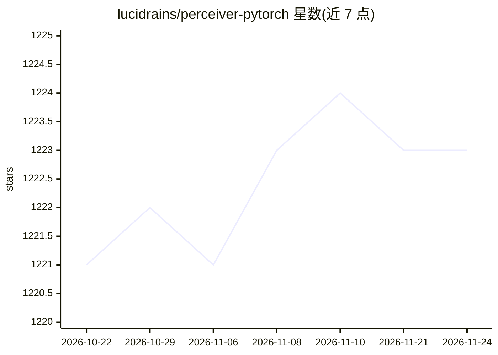

# lucidrains/perceiver-pytorch

⭐ 1,223 · Python · MIT · 推送 2026-10-26 · [GitHub](https://github.com/lucidrains/perceiver-pytorch) · 个人维护

**Perceiver 迭代注意力架构的 PyTorch 实现库**

以 PyTorch 库形式实现 Perceiver 论文提出的迭代注意力架构，提供 Perceiver、PerceiverIO（支持可变输出序列长度）、PerceiverLM（语言模型用法）与 PerceiverBlock（自定义堆叠组件）等类，另附基于 Induced Set Attention Block 的实验版本。面向需要在 PyTorch 中搭建该架构的开发者与研究者，通过 pip 安装，README 以代码示例说明各类的用法并给出引用文献。

## 筛选速览

| 维度 | 判定 | 备注 |
|---|---|---|
| AI 角色 | `ai-native` | 本体是模型或模型工具 |
| 许可风险 | `permissive` | MIT |
| 部署形态 | `library` | 以包/库形式分发 |
| 模型依赖 | — | README 未给出锁定关系 |
| 硬件要求 | — | 无带数字的原话,不猜 |
| 安装摩擦 | `low` | 无编译、无系统依赖或容器化 |
| 成熟度 | — | 结构信号不足 |

## 能力要点

- 提供 Perceiver 与 PerceiverIO 两个版本的实现
- PerceiverBlock 支持组合自定义注意力堆叠
- 含语言模型用法示例（PerceiverLM）与实验性 bottom-up attention 版本

## 适用场景

- 在 PyTorch 项目中搭建 Perceiver/PerceiverIO 模型
- 将 PerceiverIO 用作语言模型结构
- 研究迭代注意力机制的实现细节

## 场景标签

 · 领域:深度学习/模型实现

## 证据(README 行号)

> L5: Implementation of Perceiver, General Perception with Iterative Attention, in Pytorch
> L24: For the backbone of Perceiver IO, the follow up paper that allows for flexible number of output sequence length, ju
> L53: I have also included a version of Perceiver that includes bottom-up (in addition to top-down) attention, using the 

## 星数曲线

2026-10-22 1,221 → 2026-11-24 1,223（+2）

---
*卡片 v1 · prompt 1.4 · 生成 2026-11-23 · 置信度 high · 依据 README sha `640b1ed5b6bd` · [字段定义](../../DATASET.md)*
