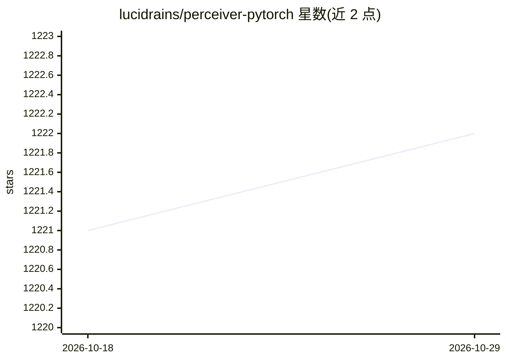

# lucidrains/perceiver-pytorch

⭐ 1,222 · Python · MIT · 推送 2026-10-26 · [GitHub](https://github.com/lucidrains/perceiver-pytorch) · 个人维护

**PyTorch 实现的 Perceiver 注意力架构模型库**

lucidrains 维护的 Perceiver 论文（General Perception with Iterative Attention）PyTorch 实现，提供 Perceiver、PerceiverIO 与 PerceiverLM 等接口，其中 PerceiverIO 支持灵活的输出序列长度，可作为语言模型骨干使用。另含实验版本，加入基于 Induced Set Attention Block 的自下而上注意力。面向深度学习研究者与开发者，通过 pip 以 Python 包形式安装，README 附引用文献条目。

## 筛选速览

| 维度 | 判定 | 备注 |
|---|---|---|
| AI 角色 | `ai-native` | 本体是模型或模型工具 |
| 许可风险 | `permissive` | MIT |
| 部署形态 | `library` | 以包/库形式分发 |
| 模型依赖 | — | README 未给出锁定关系 |
| 硬件要求 | — | 无带数字的原话,不猜 |
| 安装摩擦 | `low` | 无编译、无系统依赖或容器化 |
| 成熟度 | — | 结构信号不足 |

## 能力要点

- Perceiver 与 Perceiver IO（灵活输出长度）的 PyTorch 实现
- PerceiverLM 语言模型用法示例
- 实验版本含自下而上注意力（Induced Set Attention Block）

## 适用场景

- 在 PyTorch 项目中使用 Perceiver 架构作为模型骨干
- 复现或实验 Perceiver IO 的多模态输入输出结构
- 基于示例构建 Perceiver 语言模型

## 场景标签

 · 领域:深度学习/模型实现

## 证据(README 行号)

> L5: Implementation of Perceiver, General Perception with Iterative Attention, in Pytorch
> L24: For the backbone of Perceiver IO, the follow up paper that allows for flexible number of output sequence length, ju

## 星数曲线

2026-10-18 1,221 → 2026-10-29 1,222（+1）

---
*卡片 v1 · prompt 1.4 · 生成 2026-10-21 · 置信度 high · 依据 README sha `9e2625891ac0` · [字段定义](../../DATASET.md)*
