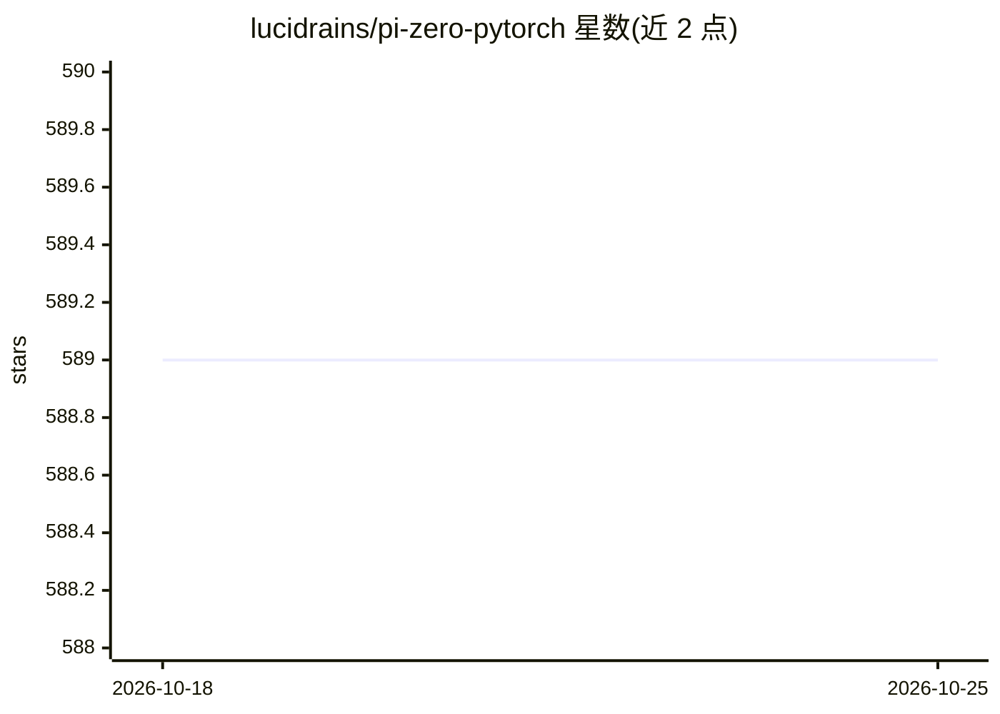

# lucidrains/pi-zero-pytorch

⭐ 589 · Python · MIT · 推送 2026-10-20 · [GitHub](https://github.com/lucidrains/pi-zero-pytorch) · 个人维护

**π₀ 机器人基础模型架构的 PyTorch 实现**

Physical Intelligence 提出的机器人基础模型 π₀ 的第三方 PyTorch 实现：在预训练视觉语言模型 PaliGemma 2B 之上，采用流匹配（flow matching）替代扩散生成机器人动作策略，并借鉴 Stable Diffusion 3 的参数分离（mmDIT 的 Joint Attention）。提供 EFPO 类封装以支持在线强化学习。以 pip 安装的 Python 库形式发布，主要面向机器人与深度学习研究者；README 大量为参考文献引用，无训练或部署细节。

## 筛选速览

| 维度 | 判定 | 备注 |
|---|---|---|
| AI 角色 | `ai-native` | 本体是模型或模型工具 |
| 许可风险 | `permissive` | MIT |
| 部署形态 | `library` | 以包/库形式分发 |
| 模型依赖 | — | README 未给出锁定关系 |
| 硬件要求 | — | 无带数字的原话,不猜 |
| 安装摩擦 | `low` | 无编译、无系统依赖或容器化 |
| 成熟度 | — | 结构信号不足 |

## 能力要点

- π₀ 架构的简化 PyTorch 实现
- 以流匹配替代扩散进行动作策略生成
- 基于 PaliGemma 2B 预训练视觉语言模型
- 提供 EFPO 类支持在线强化学习

## 适用场景

- 研究机器人基础模型的代码结构与实现细节
- 复现或扩展 π₀ 架构进行机器人策略学习实验
- 学习流匹配策略在 VLA 模型中的应用

## 场景标签

`科研工具` `强化学习` · 领域:学习与行业

## 证据(README 行号)

> L5: Implementation of π₀ the robotic foundation model architecture proposed by Physical Intelligence
> L7: Summary of this work would be that it is a simplified Transfusion (Zhou et al.) with influence from Stable Diffusion

## 星数曲线

2026-10-18 589 → 2026-10-25 589（+0）

---
*卡片 v1 · prompt 1.4 · 生成 2026-10-21 · 置信度 high · 依据 README sha `77afb8c356f4` · [字段定义](../../DATASET.md)*
