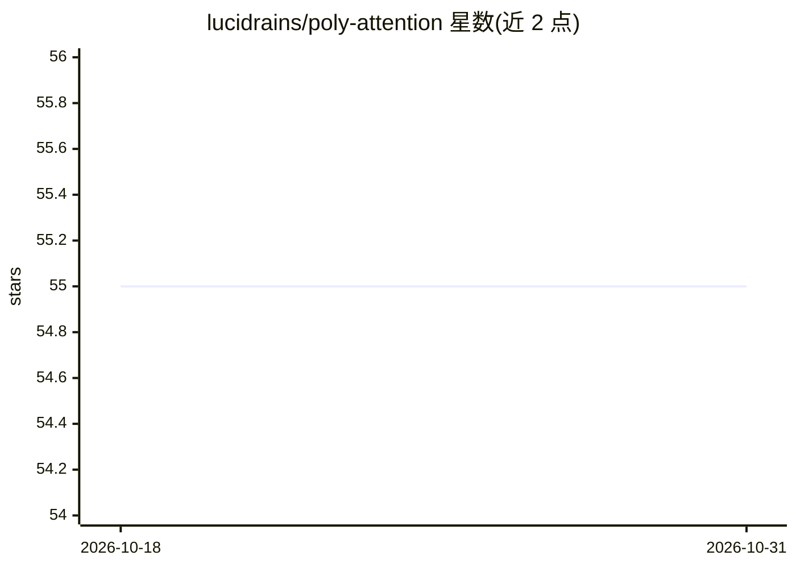

# lucidrains/poly-attention

⭐ 55 · Python · MIT · 推送 2026-08-19 · [GitHub](https://github.com/lucidrains/poly-attention) · 个人维护

**高阶自注意力 Poly-Attention 的 PyTorch 实现库**

实现 Chakrabarti 等人提出的 Poly-Attention（高阶自注意力通用方案），提供可导入的 PolyAttention 模块与基于该注意力的 Vision Transformer 变体 PolyViT，支持键值缓存与 GQA 缓存优化，附 train_function_composition.py 快速测试脚本。面向使用 PyTorch 构建与实验注意力机制变体的深度学习研究者与开发者，以 pip 包形式分发。

## 筛选速览

| 维度 | 判定 | 备注 |
|---|---|---|
| AI 角色 | `ai-native` | 本体是模型或模型工具 |
| 许可风险 | `permissive` | MIT |
| 部署形态 | `library` | 以包/库形式分发 |
| 模型依赖 | — | README 未给出锁定关系 |
| 硬件要求 | — | 无带数字的原话,不猜 |
| 安装摩擦 | `low` | 无编译、无系统依赖或容器化 |
| 成熟度 | — | 结构信号不足 |

## 能力要点

- 提供 PolyAttention 模块与 PolyViT（基于 Poly-Attention 的 Vision Transformer）
- 支持 n 阶 poly attention 的键值缓存与 GQA 缓存
- 附 train_function_composition.py 快速测试脚本

## 适用场景

- 在自有 Transformer 中替换/实验高阶注意力模块
- 复现 Poly-Attention 论文实验
- 研究注意力变体对函数复合等任务的影响

## 场景标签

 · 领域:深度学习/Transformer 组件

## 证据(README 行号)

> L3: Implementation of Poly-Attention, a general scheme for higher-order self-attention
> L20: A Vision Transformer based on Poly-Attention

## 星数曲线

2026-10-18 55 → 2026-10-31 55（+0）

---
*卡片 v1 · prompt 1.4 · 生成 2026-10-24 · 置信度 high · 依据 README sha `a38ad6965a9c` · [字段定义](../../DATASET.md)*
