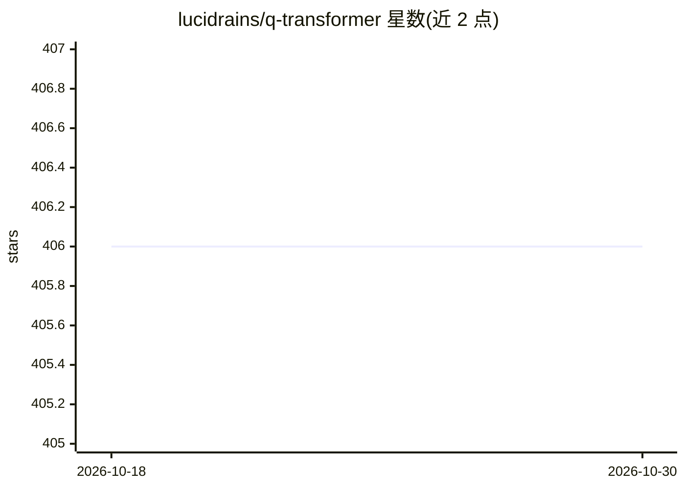

# lucidrains/q-transformer

⭐ 406 · Python · MIT · 推送 2026-08-11 · [GitHub](https://github.com/lucidrains/q-transformer) · 个人维护

**Q-Transformer 论文的 PyTorch 实现：自回归 Q 函数离线强化学习**

Google DeepMind 论文《Q-Transformer: Scalable Offline Reinforcement Learning via Autoregressive Q-Functions》的第三方 PyTorch 实现，面向机器人学与离线强化学习研究者。实现多离散动作的自回归 Q-learning、n-step Q-learning、保守正则化、可选深度对偶架构等论文组件，另提供 ReplayDataset、数据集生成器与基础环境循环等训练配套。作者声明保留单动作 Q-learning 逻辑用于对比与教学；部分扩展项（beam search、delusional bias 处理等）仍在 Todo 中未完成。以 pip 包形式提供。

## 筛选速览

| 维度 | 判定 | 备注 |
|---|---|---|
| AI 角色 | `ai-native` | 本体是模型或模型工具 |
| 许可风险 | `permissive` | MIT |
| 部署形态 | `library` | 以包/库形式分发 |
| 模型依赖 | — | README 未给出锁定关系 |
| 硬件要求 | — | 无带数字的原话,不猜 |
| 安装摩擦 | `low` | 无编译、无系统依赖或容器化 |
| 成熟度 | — | 结构信号不足 |

## 能力要点

- 自回归 Q-learning（多离散动作，奖励仅在最后动作给出）的论文主方案实现
- 含 n-step Q-learning、保守正则化、可选深度对偶架构、maxvit 变体（无 batchnorm、axial rotary、flash attention）
- 提供 ReplayDataset、数据集生成器类与基础环境循环
- 保留单动作 Q-learning 逻辑作为对比与教学参考

## 适用场景

- 复现 Q-Transformer 论文的自回归 Q 函数训练
- 机器人多动作离线强化学习实验
- 学习离线 RL 中保守正则化与探索策略的实现方式

## 场景标签

`强化学习` · 领域:训练与推理

## 证据(README 行号)

> L5: Implementation of Q-Transformer, Scalable Offline Reinforcement Learning via Autoregressive Q-Functions, out of Goog
> L39: - [x] build out main proposal in paper (autoregressive discrete actions until last action, reward given only on las

## 星数曲线

2026-10-18 406 → 2026-10-30 406（+0）

---
*卡片 v1 · prompt 1.4 · 生成 2026-10-21 · 置信度 high · 依据 README sha `bb094f0c503d` · [字段定义](../../DATASET.md)*
