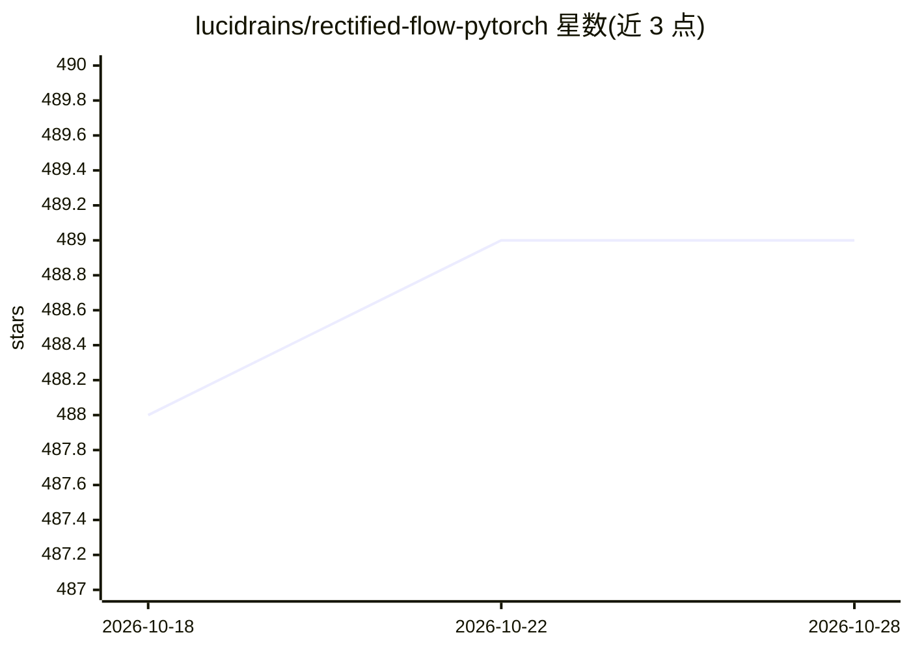

# lucidrains/rectified-flow-pytorch

⭐ 489 · Python · MIT · 推送 2026-10-13 · [GitHub](https://github.com/lucidrains/rectified-flow-pytorch) · 个人维护

**PyTorch 版 rectified flow 及其后续研究的实现库**

lucidrains 维护的 rectified flow（整流流）及其后续研究与改进的 PyTorch 实现，包含 Reflow、基于 accelerate 的 Trainer、Unet 网络与图像数据集工具。以 pip 包形式提供，附 oxford flowers 快速测试示例（pip install .[examples] 后运行 train_oxford.py）。README 主要由实现说明、用法代码片段与数十篇相关论文引用（含 SD3 的 Scaling Rectified Flow Transformers、Mean Flow 等）构成。

## 筛选速览

| 维度 | 判定 | 备注 |
|---|---|---|
| AI 角色 | `ai-native` | 本体是模型或模型工具 |
| 许可风险 | `permissive` | MIT |
| 部署形态 | `library` | 以包/库形式分发 |
| 模型依赖 | — | README 未给出锁定关系 |
| 硬件要求 | — | 无带数字的原话,不猜 |
| 安装摩擦 | `low` | 无编译、无系统依赖或容器化 |
| 成熟度 | — | 结构信号不足 |

## 能力要点

- Rectified Flow 及 Reflow 的 PyTorch 实现
- 基于 accelerate 的 Trainer 与 ImageDataset 训练工具
- 收录数十篇 rectified flow 后续研究论文引用
- oxford flowers 快速测试示例脚本

## 适用场景

- 研究/实验 rectified flow 与 flow matching 生成模型
- 复现相关论文方法或在其基础上做改进
- 学习整流流方法的代码参考实现

## 场景标签

`图像生成` · 领域:内容生成

## 证据(README 行号)

> L5: Implementation of rectified flow and some of its followup research / improvements in Pytorch
> L30: import torch

## 星数曲线

2026-10-18 488 → 2026-10-28 489（+1）

---
*卡片 v1 · prompt 1.4 · 生成 2026-10-21 · 置信度 high · 依据 README sha `166007202931` · [字段定义](../../DATASET.md)*
