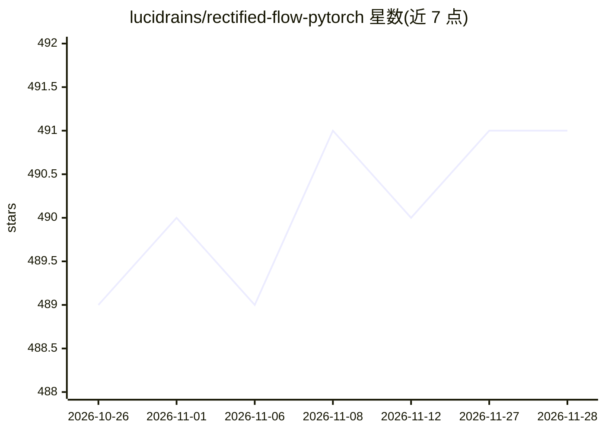

# lucidrains/rectified-flow-pytorch

⭐ 491 · Python · MIT · 推送 2026-11-27 · [GitHub](https://github.com/lucidrains/rectified-flow-pytorch) · 个人维护

**研究者用 PyTorch 实现 rectified flow 及其后续改进**

以 PyTorch 包形式实现 rectified flow 算法及其多篇后续研究的改进，提供 RectifiedFlow、Reflow、Trainer 等接口，Trainer 基于 accelerate；README 给出 pip 安装、基于 Unet 的训练示例与 oxford flowers 快速测试脚本，并附 30 余篇相关论文的 BibTeX 引用。面向深度学习研究者与开发者，用于训练基于 flow matching 的生成模型。

## 筛选速览

| 维度 | 判定 | 备注 |
|---|---|---|
| AI 角色 | `ai-native` | 本体是模型或模型工具 |
| 许可风险 | `permissive` | MIT |
| 部署形态 | `library` | 以包/库形式分发 |
| 模型依赖 | — | README 未给出锁定关系 |
| 硬件要求 | — | 无带数字的原话,不猜 |
| 安装摩擦 | `low` | 无编译、无系统依赖或容器化 |
| 成熟度 | — | 结构信号不足 |

## 能力要点

- 提供 RectifiedFlow、Reflow、Trainer 等 PyTorch 接口
- Trainer 基于 accelerate 构建训练流程
- 收录 LSD flow、SoFlow、Mean Flow、UA Flow 等多种后续实现
- 含 oxford flowers 训练示例脚本

## 适用场景

- 训练基于 rectified flow 的图像生成模型
- 复现 flow matching 相关论文的实验
- 在自定义数据集上跑通 reflow 流程

## 场景标签

`模型训练` · 领域:训练与推理

## 证据(README 行号)

> L5: Implementation of rectified flow and some of its followup research / improvements in Pytorch
> L24: $ pip install rectified-flow-pytorch

## 星数曲线

2026-10-26 489 → 2026-11-28 491（+2）

---
*卡片 v1 · prompt 1.4 · 生成 2026-11-28 · 置信度 high · 依据 README sha `0fd5a7006042` · [字段定义](../../DATASET.md)*
