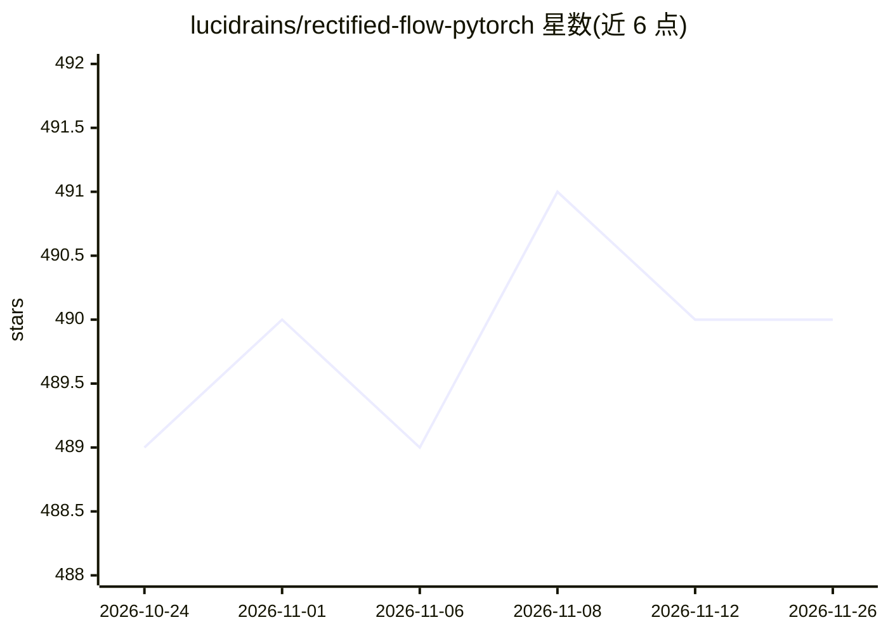

# lucidrains/rectified-flow-pytorch

⭐ 490 · Python · MIT · 推送 2026-11-25 · [GitHub](https://github.com/lucidrains/rectified-flow-pytorch) · 个人维护

**研究者的 Rectified Flow 及后续方法 PyTorch 实现库**

以 PyTorch 库形式实现 Rectified Flow 及多项后续研究改进，包含 LSD flow、SoFlow、Split Mean Flow、Unconstrained Alignment Flow、Laplacian 多尺度 flow matching 等贡献者列名的实现。提供 RectifiedFlow、Reflow、Trainer 等类，Trainer 基于 accelerate；含 reflow 训练流程与基于 oxford flowers 数据集的示例训练脚本。通过 pip 安装，示例依赖需 pip install .[examples]。面向深度学习研究者与工程师，用于生成模型的训练与实验。

## 筛选速览

| 维度 | 判定 | 备注 |
|---|---|---|
| AI 角色 | `ai-native` | 本体是模型或模型工具 |
| 许可风险 | `permissive` | MIT |
| 部署形态 | `library` | 以包/库形式分发 |
| 模型依赖 | — | README 未给出锁定关系 |
| 硬件要求 | — | 无带数字的原话,不猜 |
| 安装摩擦 | `low` | 无编译、无系统依赖或容器化 |
| 成熟度 | — | 结构信号不足 |

## 能力要点

- 实现 Rectified Flow 及多项后续改进（SoFlow、Mean Flow、Consistency Flow Matching 等）
- 提供基于 accelerate 的 Trainer 与 Reflow 训练流程
- pip 安装，附带 oxford flowers 快速上手示例脚本

## 适用场景

- 训练基于 rectified flow 的图像生成模型
- 复现 flow matching 相关论文方法做研究实验
- 用 reflow 流程加速已有生成模型采样

## 场景标签

`图像生成` `模型训练` · 领域:内容生成

## 证据(README 行号)

> L5: Implementation of rectified flow and some of its followup research / improvements in Pytorch
> L24: $ pip install rectified-flow-pytorch
> L45: With a `Trainer` based on `accelerate`

## 星数曲线

2026-10-24 489 → 2026-11-26 490（+1）

---
*卡片 v1 · prompt 1.4 · 生成 2026-11-25 · 置信度 high · 依据 README sha `7413b92d4340` · [字段定义](../../DATASET.md)*
