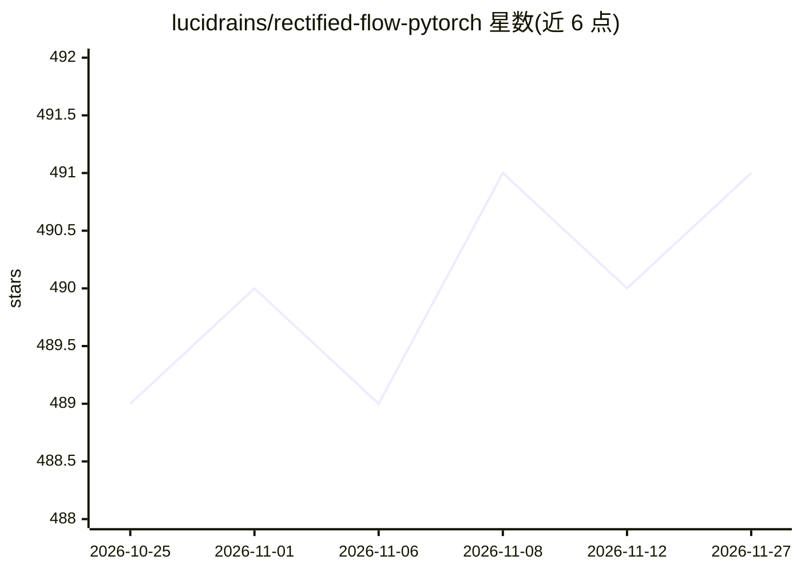

# lucidrains/rectified-flow-pytorch

⭐ 491 · Python · MIT · 推送 2026-11-25 · [GitHub](https://github.com/lucidrains/rectified-flow-pytorch) · 个人维护

**给深度学习研究者的 rectified flow PyTorch 实现**

在 PyTorch 中实现 rectified flow 及其多项后续研究改进的库，提供 RectifiedFlow、Reflow、Trainer 等类，Trainer 基于 accelerate 构建，附 oxford flowers 训练示例（pip install .[examples] 后运行 train_oxford.py）。README 以用法代码示例为主，其余篇幅为约 30 篇相关论文的 BibTeX 引用列表，覆盖 flow matching、一致性模型、流策略优化等方向。面向研究复现与实验用途。

## 筛选速览

| 维度 | 判定 | 备注 |
|---|---|---|
| AI 角色 | `ai-native` | 本体是模型或模型工具 |
| 许可风险 | `permissive` | MIT |
| 部署形态 | `library` | 以包/库形式分发 |
| 模型依赖 | — | README 未给出锁定关系 |
| 硬件要求 | — | 无带数字的原话,不猜 |
| 安装摩擦 | `low` | 无编译、无系统依赖或容器化 |
| 成熟度 | — | 结构信号不足 |

## 能力要点

- RectifiedFlow / Reflow / Trainer（基于 accelerate）等 PyTorch 组件
- 附 oxford flowers 训练示例脚本 train_oxford.py
- 收录约 30 篇后续研究的 BibTeX 引用（LSD flow、SoFlow、Mean Flow、UA Flow 等）

## 适用场景

- 在 PyTorch 中训练 rectified flow 生成模型
- 对论文做 reflow 实验
- 基于 flow matching 后续方法做生成建模研究

## 场景标签

`模型训练` `图像生成` · 领域:内容生成

## 证据(README 行号)

> L5: Implementation of rectified flow and some of its followup research / improvements in Pytorch
> L30: import torch

## 星数曲线

2026-10-25 489 → 2026-11-27 491（+2）

---
*卡片 v1 · prompt 1.4 · 生成 2026-11-26 · 置信度 high · 依据 README sha `61591fae2d37` · [字段定义](../../DATASET.md)*
