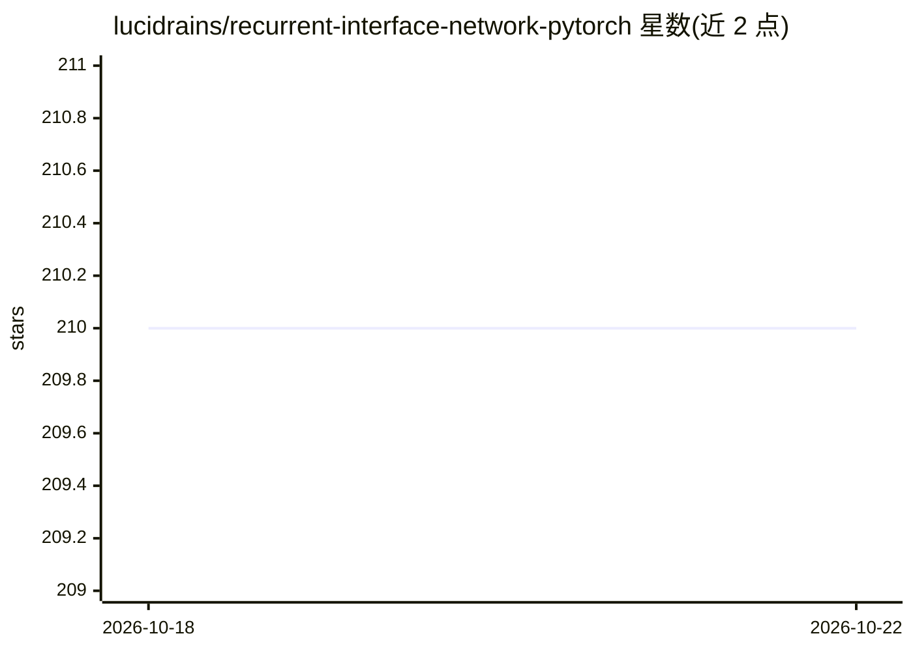

# lucidrains/recurrent-interface-network-pytorch

⭐ 210 · Python · MIT · 推送 2026-06-11 · [GitHub](https://github.com/lucidrains/recurrent-interface-network-pytorch) · 个人维护

**PyTorch 实现的 Recurrent Interface Network 图像/视频生成模型库**

lucidrains 维护的 RIN（Recurrent Interface Network）PyTorch 实现，用于无需级联网络的高效图像与视频扩散生成。实现包含 induced set-attention block、latents 自条件机制与基于 sigmoid 的噪声调度，GaussianDiffusion 类支持通过 scale 参数对更高分辨率图像施加更多噪声，附带 Trainer 训练器，结果定期保存至 ./results。以 pip 包 rin-pytorch 提供，面向扩散模型研究者与开发者，README 含未完成的实验 Todo。

## 筛选速览

| 维度 | 判定 | 备注 |
|---|---|---|
| AI 角色 | `ai-native` | 本体是模型或模型工具 |
| 许可风险 | `permissive` | MIT |
| 部署形态 | `library` | 以包/库形式分发 |
| 模型依赖 | — | README 未给出锁定关系 |
| 硬件要求 | — | 无带数字的原话,不猜 |
| 安装摩擦 | `low` | 无编译、无系统依赖或容器化 |
| 成熟度 | — | 结构信号不足 |

## 能力要点

- RIN 架构的 PyTorch 实现，用于图像与视频扩散生成
- 提供 GaussianDiffusion 类，支持 scale 参数处理高分辨率加噪
- 提供 Trainer 训练器，训练结果定期保存
- 实现 latents 自条件与 sigmoid 噪声调度

## 适用场景

- 研究和复现 RIN 扩散生成架构
- 实验自条件机制与不同噪声调度对生成的影响
- 作为基础组件构建图像或视频扩散生成项目

## 场景标签

`图像生成` `视频生成` · 领域:内容生成

## 证据(README 行号)

> L7: Implementation of Recurrent Interface Network (RIN), for highly efficient generation of images and video without cas
> L24: $ pip install rin-pytorch

## 星数曲线

2026-10-18 210 → 2026-10-22 210（+0）

---
*卡片 v1 · prompt 1.4 · 生成 2026-10-22 · 置信度 high · 依据 README sha `6948a5434d92` · [字段定义](../../DATASET.md)*
