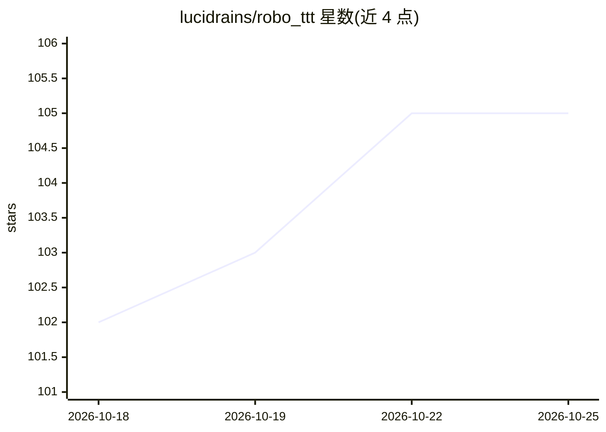

# lucidrains/robo_ttt

⭐ 105 · Python · MIT · 推送 2026-09-17 · [GitHub](https://github.com/lucidrains/robo_ttt) · 个人维护

**RoboTTT 论文的 PyTorch 实现：机器人策略的测试时训练**

实现 Yunfan Jiang 等（Stanford/Nvidia）提出的 RoboTTT：面向机器人策略的测试时训练（test-time training）框架。提供 MemoryKeyValueBind、TTTWrapper（2 层 MLP 记忆）、fwPKMWrapper（Fast Weight Product Key Memory，Tianyu Zhao & Llion Jones）等组件，可独立使用，也可包装 MimicVideo 等策略模型。另支持潜空间前向动力学建模（next latent prediction，predict_next_latent 选项），以下一状态表示预测监督动作生成，无需原始像素重建。以 Python 库（pip 安装）形式提供。

## 筛选速览

| 维度 | 判定 | 备注 |
|---|---|---|
| AI 角色 | `ai-native` | 本体是模型或模型工具 |
| 许可风险 | `permissive` | MIT |
| 部署形态 | `library` | 以包/库形式分发 |
| 模型依赖 | — | README 未给出锁定关系 |
| 硬件要求 | — | 无带数字的原话,不猜 |
| 安装摩擦 | `low` | 无编译、无系统依赖或容器化 |
| 成熟度 | — | 结构信号不足 |

## 能力要点

- 提供 MemoryKeyValueBind / TTTWrapper / fwPKMWrapper 测试时训练组件
- RoboTTT 包装器可套用 MimicVideo 等策略模型
- 支持 next latent 前向动力学（predict_next_latent），无需像素重建

## 适用场景

- 为机器人策略模型加入测试时训练能力
- 在动作生成中引入下一潜状态预测监督
- 研究快速权重记忆在策略学习中的应用

## 场景标签

 · 领域:机器人/深度学习

## 证据(README 行号)

> L5: Implementation of RoboTTT proposed by Yunfan Jiang et al. of Stanford and Nvidia.
> L37: Wrapping a policy model (e.g. `MimicVideo`) with `RoboTTT`:

## 星数曲线

2026-10-18 102 → 2026-10-25 105（+3）

---
*卡片 v1 · prompt 1.4 · 生成 2026-10-23 · 置信度 high · 依据 README sha `0c61f8574ed0` · [字段定义](../../DATASET.md)*
