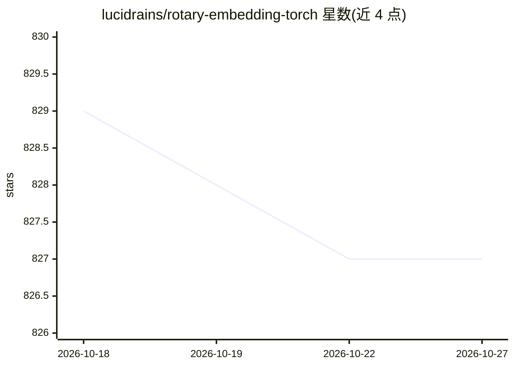

# lucidrains/rotary-embedding-torch

⭐ 827 · Python · MIT · 推送 2026-06-20 · [GitHub](https://github.com/lucidrains/rotary-embedding-torch) · 个人维护

**PyTorch 旋转位置编码（RoPE）独立实现库，供 Transformer 使用**

将 RoFormer 论文提出的旋转位置编码实现为独立的 PyTorch 库，供研究者和开发者在自建 Transformer 中加入旋转式相对位置编码。提供推理时 KV cache 的 query 旋转偏移方法、n 维轴向旋转编码（适用于视频 Transformer）、XPos 长度外推、位置插值与 NTK-Aware 缩放等选项，并支持融合 Flash Attention 的 Triton 内核（不可用时回退到 PyTorch CPU/GPU 实现）。以 pip 包安装，使用方式为嵌入自有模型代码。

## 筛选速览

| 维度 | 判定 | 备注 |
|---|---|---|
| AI 角色 | `ai-ecosystem` | LLM/agent 周边工具 |
| 许可风险 | `permissive` | MIT |
| 部署形态 | `library` | 以包/库形式分发 |
| 模型依赖 | — | README 未给出锁定关系 |
| 硬件要求 | — | 无带数字的原话,不猜 |
| 安装摩擦 | `low` | 无编译、无系统依赖或容器化 |
| 成熟度 | — | 结构信号不足 |

## 能力要点

- RoFormer 旋转位置编码的 PyTorch 独立实现
- 推理 KV cache 场景的 rotate_queries_with_cached_keys 方法
- XPos 长度外推、位置插值（interpolate_factor）等长度扩展选项
- 融合 Flash Attention 与旋转的 Triton 内核，缺失 Triton 时回退 PyTorch 实现

## 适用场景

- 在自建 Transformer 模型中加入旋转相对位置编码
- 视频等 n 维输入的轴向相对位置编码
- 为预训练模型做上下文长度扩展的实验

## 场景标签

 · 领域:深度学习/模型组件

## 证据(README 行号)

> L5: A standalone library for adding rotary embeddings to transformers in Pytorch, following its success as relative posi
> L88: You can also use a fused Flash Attention kernel that computes attention with rotary embeddings in one pass. It auto

## 星数曲线

2026-10-18 829 → 2026-10-27 827（-2）

---
*卡片 v1 · prompt 1.4 · 生成 2026-10-21 · 置信度 high · 依据 README sha `32940de4cdf2` · [字段定义](../../DATASET.md)*
