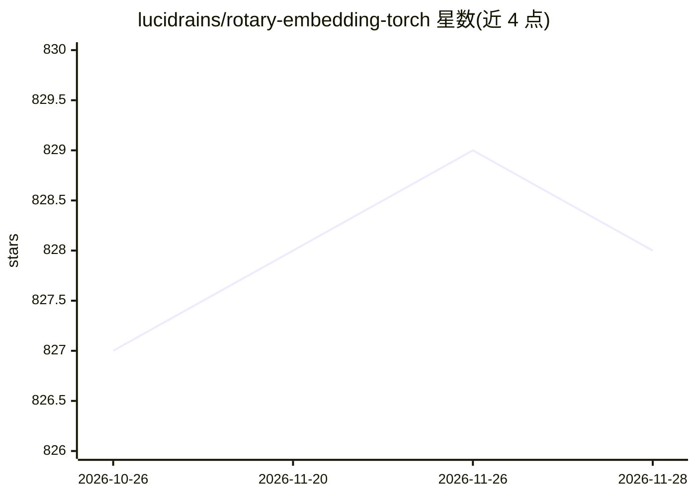

# lucidrains/rotary-embedding-torch

⭐ 828 · Python · MIT · 推送 2026-11-07 · [GitHub](https://github.com/lucidrains/rotary-embedding-torch) · 个人维护

**PyTorch 开发者为 transformer 添加旋转位置编码的库**

一个独立的 PyTorch 库，用于为 transformer 添加旋转位置编码（RoPE，出自 RoFormer 论文），支持固定位置与可学习位置的旋转。提供逆向旋转、推理阶段 KV 缓存的查询位置偏移、n 维轴向旋转（如视频 transformer）、带衰减的 XPos 长度外推选项，以及按插值因子微调扩展上下文长度的机制。通过 pip 安装，并附 Triton 融合 Flash Attention 与旋转的一体化核函数（无 Triton 时回退到 PyTorch 参考实现）。

## 筛选速览

| 维度 | 判定 | 备注 |
|---|---|---|
| AI 角色 | `ai-native` | 本体是模型或模型工具 |
| 许可风险 | `permissive` | MIT |
| 部署形态 | `library` | 以包/库形式分发 |
| 模型依赖 | — | README 未给出锁定关系 |
| 硬件要求 | — | 无带数字的原话,不猜 |
| 安装摩擦 | `low` | 无编译、无系统依赖或容器化 |
| 成熟度 | — | 结构信号不足 |

## 能力要点

- 为 PyTorch tensor 任意轴添加旋转信息（固定或可学习位置）
- 推理 KV 缓存场景的 rotate_queries_with_cached_keys 方法
- 轴向旋转与 XPos 长度外推、interpolate_factor 位置插值
- 融合 Flash Attention 的旋转注意力核，无 Triton 时回退参考实现

## 适用场景

- 为自研 transformer 模型引入 RoPE 相对位置编码
- 推理阶段处理 KV 缓存的查询位置偏移
- 微调预训练模型以扩展上下文长度
- 视频等 n 维数据的轴向相对位置编码

## 场景标签

 · 领域:深度学习/模型组件

## 证据(README 行号)

> L5: A standalone library for adding rotary embeddings to transformers in Pytorch, following its success as relative posi
> L14: $ pip install rotary-embedding-torch

## 星数曲线

2026-10-26 827 → 2026-11-28 828（+1）

---
*卡片 v1 · prompt 1.4 · 生成 2026-11-25 · 置信度 high · 依据 README sha `89f8d07b5a4e` · [字段定义](../../DATASET.md)*
