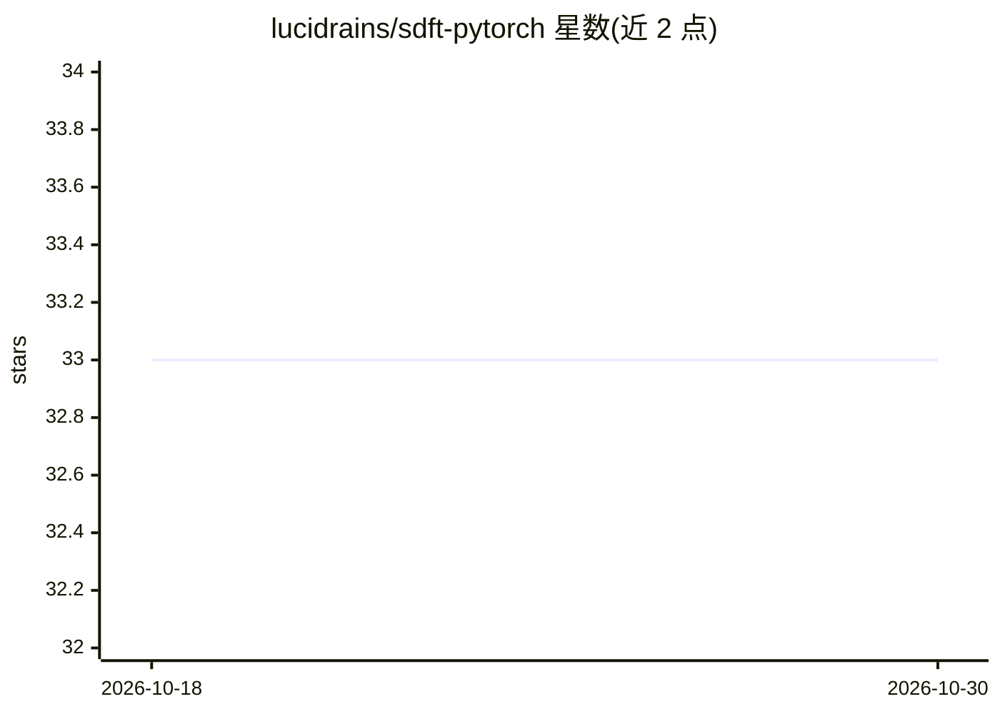

# lucidrains/sdft-pytorch

⭐ 33 · Python · MIT · 推送 2026-02-06 · [GitHub](https://github.com/lucidrains/sdft-pytorch) · 个人维护

**SDFT 自蒸馏持续学习方法的 PyTorch 探索实现**

对 Shenfeld 等人（MIT）提出的 SDFT（Self-Distillation Enables Continual Learning）进行 PyTorch 复现与探索的项目。README 仅包含标题、方法描述与论文引用信息，未提供安装方式、依赖说明或使用示例，且标题标注 wip（进行中），处于早期阶段。面向关注持续学习与自蒸馏方向的深度学习研究者。

## 筛选速览

| 维度 | 判定 | 备注 |
|---|---|---|
| AI 角色 | `ai-native` | 本体是模型或模型工具 |
| 许可风险 | `permissive` | MIT |
| 部署形态 | `None` |  |
| 模型依赖 | — | README 未给出锁定关系 |
| 硬件要求 | — | 无带数字的原话,不猜 |
| 安装摩擦 | `low` | 无编译、无系统依赖或容器化 |
| 成熟度 | `idea` | |

## 能力要点

- PyTorch 实现论文提出的 SDFT 自蒸馏持续学习方法
- 引用 Shenfeld 等人的原始论文

## 适用场景

- 复现或研究 SDFT 自蒸馏持续学习方法
- 作为持续学习实验的代码基础

## 场景标签

`科研工具` · 领域:学习与行业

## 证据(README 行号)

> L3: ## SDFT - Pytorch (wip)
> L5: Explorations into the proposed SDFT, Self-Distillation Enables Continual Learning, from Shenfeld et al. of MIT

## 星数曲线

2026-10-18 33 → 2026-10-30 33（+0）

---
*卡片 v1 · prompt 1.4 · 生成 2026-10-26 · 置信度 mid · 依据 README sha `9910bab9e3cc` · [字段定义](../../DATASET.md)*
