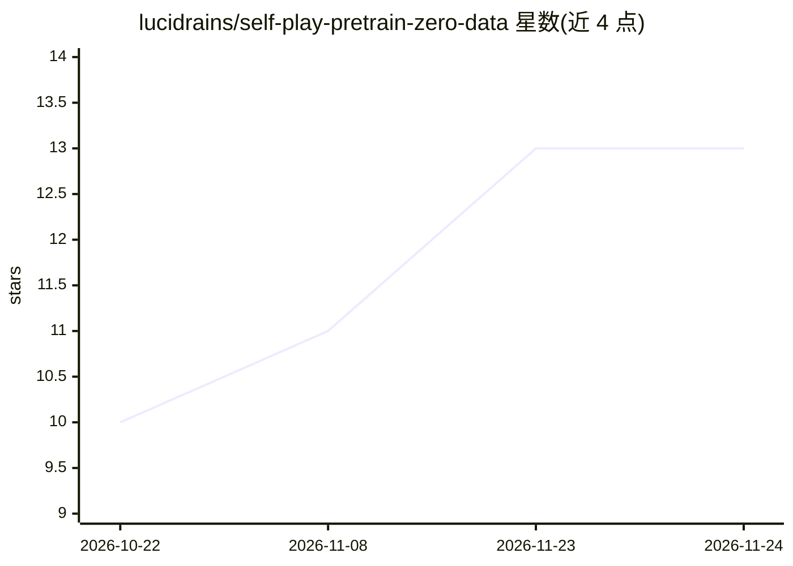

# lucidrains/self-play-pretrain-zero-data

⭐ 13 · Python · MIT · 推送 2026-11-22 · [GitHub](https://github.com/lucidrains/self-play-pretrain-zero-data) · 个人维护

**Self-Play Pretraining with Zero Data 论文的 PyTorch 实现库**

lucidrains 维护的论文复现库，实现 Self-Play Pretraining with Zero Data 方法：learner 从零开始在生成器采样的程序上训练，无需外部数据。支持配置 fresh/mutation/replay 三类程序源及权重，可通过 QualityDiversityArchive 启用存档，允许注入自定义程序源函数。通过 pip 安装，附带复现 Table 1 的实验脚本，含自动打开的 dashboard。

## 筛选速览

| 维度 | 判定 | 备注 |
|---|---|---|
| AI 角色 | `ai-native` | 本体是模型或模型工具 |
| 许可风险 | `permissive` | MIT |
| 部署形态 | `library` | 以包/库形式分发 |
| 模型依赖 | — | README 未给出锁定关系 |
| 硬件要求 | — | 无带数字的原话,不猜 |
| 安装摩擦 | `low` | 无编译、无系统依赖或容器化 |
| 成熟度 | — | 结构信号不足 |

## 能力要点

- Self-Play Pretraining with Zero Data 论文实现
- fresh/mutation/replay 三类程序源可配权重混合
- 支持自定义程序源函数（program_batch 包装）
- 提供复现实验脚本与 dashboard

## 适用场景

- 复现论文中 self-play 从零发现算术/几何/fibonacci 程序的实验
- 研究无外部数据的预训练方法
- 在此基础上试验自定义程序生成源

## 场景标签

`模型训练` · 领域:训练与推理

## 证据(README 行号)

> L5: Implementation of Self-Play Pretraining with Zero Data
> L12: $ pip install self-play-pretrain-zero-data
> L58: Self-play discovers arithmetic, geometric and fibonacci programs from zero data, far above uniform sampling, with t

## 星数曲线

2026-10-22 10 → 2026-11-24 13（+3）

---
*卡片 v1 · prompt 1.4 · 生成 2026-11-18 · 置信度 high · 依据 README sha `bc404a333068` · [字段定义](../../DATASET.md)*
