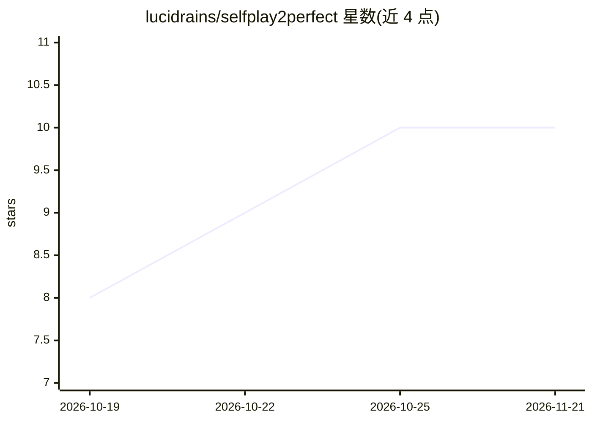

# lucidrains/selfplay2perfect

⭐ 10 · Python · MIT · 推送 2026-11-04 · [GitHub](https://github.com/lucidrains/selfplay2perfect) · 个人维护

**面向开发者的 Play2Perfect 强化学习预训练复现库（含自博弈）**

以 pip 包形式提供的深度强化学习训练库，复现 Stanford Tyler Ga Wei Lum 等人的 Play2Perfect 工作，并在其基础上加入 Self Play 元素与 AlphaNIST Success-Guided Sampling（SGS）。README 提供安装命令与 Python 用法示例，导出 ActorCritic、PickAndPlaceCurriculum 等组件，并附四篇论文的 BibTeX 引用。项目标注为 WIP（进行中），使用说明以简短代码示例呈现，面向研究者与开发者。

## 筛选速览

| 维度 | 判定 | 备注 |
|---|---|---|
| AI 角色 | `ai-native` | 本体是模型或模型工具 |
| 许可风险 | `permissive` | MIT |
| 部署形态 | `library` | 以包/库形式分发 |
| 模型依赖 | — | README 未给出锁定关系 |
| 硬件要求 | — | 无带数字的原话,不猜 |
| 安装摩擦 | `low` | 无编译、无系统依赖或容器化 |
| 成熟度 | `idea` | |

## 能力要点

- 复现 Play2Perfect 并加入 Self Play 元素
- 引入 AlphaNIST Success-Guided Sampling（SGS）
- 提供 ActorCritic、PickAndPlaceCurriculum 等组件
- 附四篇相关论文的 BibTeX 引用

## 适用场景

- 对机器人灵巧操作预训练方法做研究复现
- 在自博弈课程任务中训练 ActorCritic 策略
- 参考 Success-Guided Sampling 的强化学习训练流程

## 场景标签

`模型训练` `强化学习` · 领域:训练与推理

## 证据(README 行号)

> L3: Implementation of Play2Perfect, from Tyler Ga Wei Lum et al. of Stanford, with a Self Play element and AlphaNIST Suc
> L14: from selfplay2perfect import (

## 星数曲线

2026-10-19 8 → 2026-11-21 10（+2）

---
*卡片 v1 · prompt 1.4 · 生成 2026-11-19 · 置信度 high · 依据 README sha `5c2d5aa82a85` · [字段定义](../../DATASET.md)*
