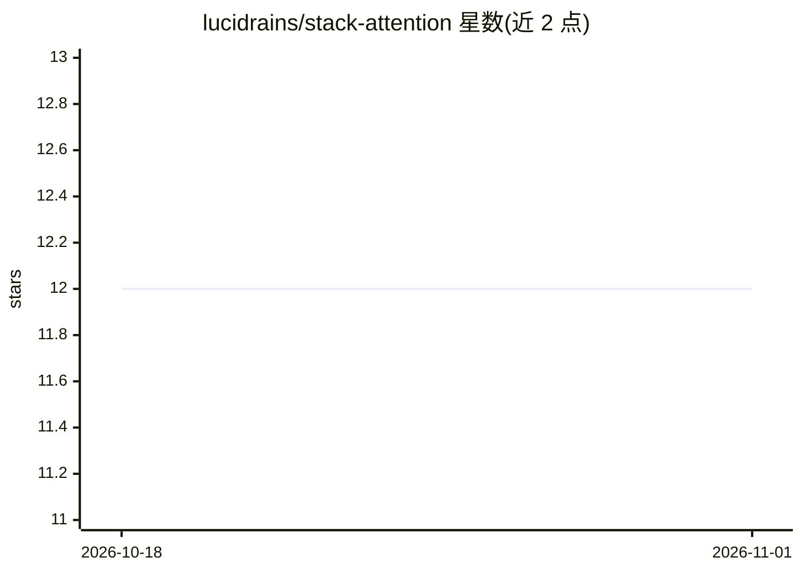

# lucidrains/stack-attention

⭐ 12 · Python · MIT · 推送 2026-09-22 · [GitHub](https://github.com/lucidrains/stack-attention) · 个人维护

**PyTorch 库：为注意力机制增加可微分栈结构**

lucidrains 维护的研究跟进型 PyTorch 库，实现 DuSell 等人在 ETH Zurich 提出的 Stack Attention：在 Transformer 注意力中引入可微分栈数据结构，以建模层级模式。提供 StackTransLayer 即用层，以及 DataStructureTransLayer 供用户声明自定义可微数据结构。以 pip 包 stack-attention-pytorch 分发，README 标注 wip（开发中）。附 Stack Attention、StackTrans 及 Joulin & Mikolov 2015 三篇引用文献。

## 筛选速览

| 维度 | 判定 | 备注 |
|---|---|---|
| AI 角色 | `ai-native` | 本体是模型或模型工具 |
| 许可风险 | `permissive` | MIT |
| 部署形态 | `library` | 以包/库形式分发 |
| 模型依赖 | — | README 未给出锁定关系 |
| 硬件要求 | — | 无带数字的原话,不猜 |
| 安装摩擦 | `low` | 无编译、无系统依赖或容器化 |
| 成熟度 | `idea` | |

## 能力要点

- StackTransLayer：注意力结合可微分栈的即用层
- DataStructureTransLayer 支持自定义可微数据结构
- 以 pip 包 stack-attention-pytorch 分发

## 适用场景

- 在 Transformer 中实验层级/栈式结构建模能力
- 跟进 Stack Attention / StackTrans 研究线并复现
- 构建自定义可微分数据结构的注意力层

## 场景标签

 · 领域:深度学习/模型结构研究

## 证据(README 行号)

> L3: For following a line of research that augments attention with a differentiable stack, beginning with DuSell et al. a
> L13: ### StackTransLayer

## 星数曲线

2026-10-18 12 → 2026-11-01 12（+0）

---
*卡片 v1 · prompt 1.4 · 生成 2026-11-01 · 置信度 high · 依据 README sha `3bb691fb5580` · [字段定义](../../DATASET.md)*
