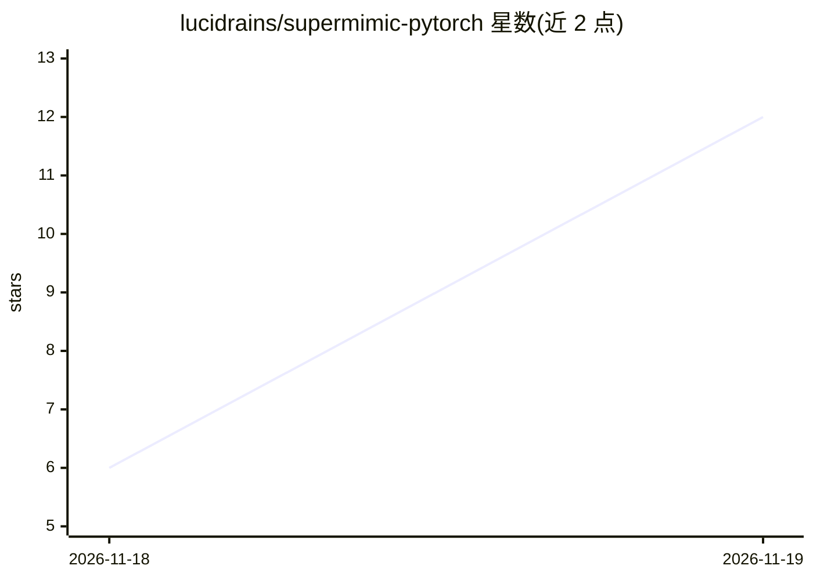

# lucidrains/supermimic-pytorch

⭐ 12 · Python · MIT · 推送 2026-11-18 · [GitHub](https://github.com/lucidrains/supermimic-pytorch) · 个人维护

**Supermimic 论文的非官方 PyTorch 实现（进行中）**

lucidrains 维护的 Supermimic（基于单一可微世界模型的人形全身控制）非官方 PyTorch 实现，标注为 wip。README 提供 pip 安装命令与一段 Python 用法示例，示例中通过 torch、nn 与 x_mlps_pytorch 的 MLP 组件构建模型。仓库以 BibTeX 条目给出 SuperMimic 原论文及两篇相关论文（APL、PWM）的引用信息。README 未描述训练流程、预训练权重或仿真环境接入方式。

## 筛选速览

| 维度 | 判定 | 备注 |
|---|---|---|
| AI 角色 | `ai-native` | 本体是模型或模型工具 |
| 许可风险 | `permissive` | MIT |
| 部署形态 | `library` | 以包/库形式分发 |
| 模型依赖 | — | README 未给出锁定关系 |
| 硬件要求 | — | 无带数字的原话,不猜 |
| 安装摩擦 | `low` | 无编译、无系统依赖或容器化 |
| 成熟度 | — | 结构信号不足 |

## 能力要点

- Supermimic 论文的非官方 PyTorch 实现（wip）
- 提供 pip install 安装途径
- 以 BibTeX 引用原论文及两篇相关论文

## 适用场景

- 在 PyTorch 中复现 Supermimic 的人形全身控制方法
- 基于可微世界模型开展机器人控制策略研究

## 场景标签

 · 领域:机器人/深度学习研究

## 证据(README 行号)

> L5: Unofficial implementation of Supermimic, Scaling Humanoid Whole-Body Control with One Differentiable World Model, fr
> L16: import torch

## 星数曲线

2026-11-18 6 → 2026-11-19 12（+6）

---
*卡片 v1 · prompt 1.4 · 生成 2026-11-19 · 置信度 high · 依据 README sha `a75327791107` · [字段定义](../../DATASET.md)*
