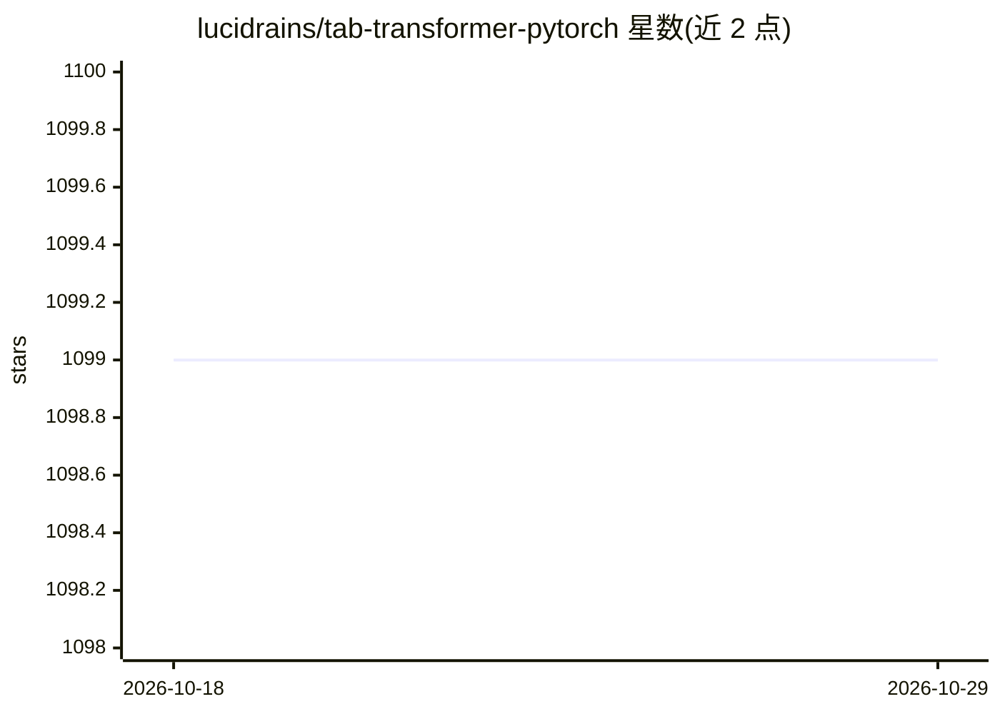

# lucidrains/tab-transformer-pytorch

⭐ 1,099 · Python · MIT · 推送 2026-01-08 · [GitHub](https://github.com/lucidrains/tab-transformer-pytorch) · 个人维护

**TabTransformer 表格数据注意力网络的 PyTorch 实现**

lucidrains 维护的 PyTorch 模型实现库，复现 TabTransformer——一种用于表格数据的注意力网络架构，并附 FT Transformer（Yandex 论文方案）便于对比。支持将类别特征转为唯一 id 后用 Electra 做 model.transformer 的无监督预训练。以 pip 包形式提供，含使用示例代码与论文引用；README 提及 Todo 中待考虑 arXiv:2203.05556。面向表格数据深度学习的研究者与开发者。

## 筛选速览

| 维度 | 判定 | 备注 |
|---|---|---|
| AI 角色 | `ai-native` | 本体是模型或模型工具 |
| 许可风险 | `permissive` | MIT |
| 部署形态 | `library` | 以包/库形式分发 |
| 模型依赖 | — | README 未给出锁定关系 |
| 硬件要求 | — | 无带数字的原话,不猜 |
| 安装摩擦 | `low` | 无编译、无系统依赖或容器化 |
| 成熟度 | — | 结构信号不足 |

## 能力要点

- TabTransformer 的 PyTorch 实现与使用示例
- 附 FT Transformer（连续值嵌入方案）便于对比
- 支持基于 Electra 的无监督预训练路径

## 适用场景

- 在 PyTorch 中对表格数据训练注意力网络模型
- 对比 TabTransformer 与 FT Transformer 两种架构
- 复现表格数据上下文嵌入相关论文方法

## 场景标签

`模型训练` · 领域:训练与推理

## 证据(README 行号)

> L5: Implementation of Tab Transformer, attention network for tabular data, in Pytorch. This simple architecture came wit
> L20: from tab_transformer_pytorch import TabTransformer

## 星数曲线

2026-10-18 1,099 → 2026-10-29 1,099（+0）

---
*卡片 v1 · prompt 1.4 · 生成 2026-10-21 · 置信度 high · 依据 README sha `22093960051c` · [字段定义](../../DATASET.md)*
