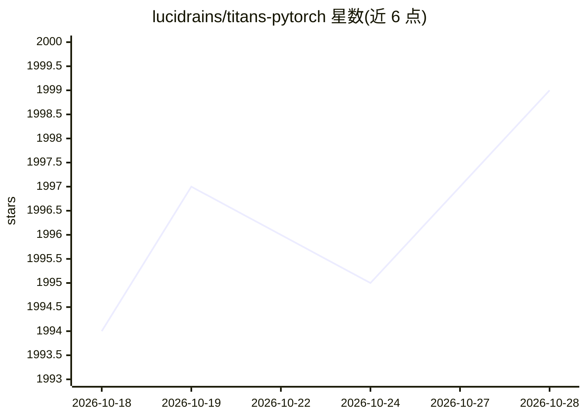

# lucidrains/titans-pytorch

⭐ 2,001 · Python · MIT · 推送 2026-07-13 · [GitHub](https://github.com/lucidrains/titans-pytorch) · 个人维护

**Titans 神经记忆模块的 PyTorch 非官方实现，供研究者使用**

以 Python/PyTorch 库形式实现的 Titans（Learning to Memorize at Test Time）非官方架构：提供 NeuralMemory 神经记忆模块与 MemoryAsContextTransformer（MAC 配置）的 Transformer 封装，并计划探索记忆模块中超越原论文 1-4 层 MLP 的结构。附带 Colab 快速运行入口与 train_mac.py 实验脚本。面向深度学习研究者与工程开发者，pip 安装即用，属研究性代码（作者声明非官方实现）。

## 筛选速览

| 维度 | 判定 | 备注 |
|---|---|---|
| AI 角色 | `ai-native` | 本体是模型或模型工具 |
| 许可风险 | `permissive` | MIT |
| 部署形态 | `library` | 以包/库形式分发 |
| 模型依赖 | — | README 未给出锁定关系 |
| 硬件要求 | — | 无带数字的原话,不猜 |
| 安装摩擦 | `low` | 无编译、无系统依赖或容器化 |
| 成熟度 | — | 结构信号不足 |

## 能力要点

- NeuralMemory 神经记忆模块的 PyTorch 实现
- 提供 MAC 配置的 MemoryAsContextTransformer
- 附 Colab 快速运行与 train_mac.py 实验脚本
- 计划探索记忆模块中非 MLP 替代结构

## 适用场景

- 在自研 Transformer 中试验测试时训练的神经记忆
- 复现或扩展 Titans 论文思路
- 学习长程记忆架构的实现方式

## 场景标签

 · 领域:深度学习/模型架构

## 证据(README 行号)

> L7: Unofficial implementation of Titans in Pytorch. Will also contain some explorations into architectures beyond their 
> L25: ```python

## 星数曲线



2026-10-18 1,994 → 2026-10-28 1,999（+5）


---
*卡片 v1 · prompt 1.4 · 生成 2026-10-21 · 置信度 high · 依据 README sha `7ddf67d0875f` · [字段定义](../../DATASET.md)*
